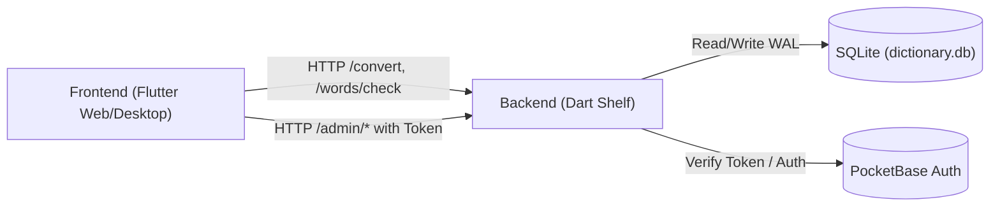

# Cyrillic to Traditional Mongolian Converter Blueprint

A web and desktop suite for converting Cyrillic Mongolian text into Traditional Mongolian vertical script (`ᠮᠣᠩᠭᠣᠯ ᠪᠢᠴᠢᠭ`), resolving homonyms, managing dictionary definitions, and crowd-sourcing missing words with moderator checking.

---

## System Overview

The system consists of a Flutter desktop-style web/desktop workspace communicating with a Dart Shelf HTTP server backed by SQLite 3 (in WAL mode). The converter converts Cyrillic text to Traditional Mongolian script using Menksoft encoding glyphs, facilitates homonym selection, records unknown terms with privacy-safe sentence contexts, and provides an end-to-end moderation workflow for community dictionary contributions.



---

## Subdirectories & System Boundaries

- [backend](./backend/README.md): Dart Shelf server with SQLite 3 (WAL mode) powering the Cyrillic to Traditional Mongolian conversion engine, dictionary queries, moderation workflow, and atomic database backups.
- [frontend](./frontend/README.md): Flutter client application supporting Web and Desktop platforms, providing vertical text rendering, homonym disambiguation, and community word moderation.

---

## Global Invariants

- **Lossless Text Roundtrip**: The tokenizer guarantees `tokens.map((t) => t.text).join() == input` across arbitrary input strings, ensuring whitespace, punctuation, and newlines are never corrupted during conversion.
- **Pure Cyrillic Script Integrity**: Terms must strictly consist of Cyrillic characters and connector punctuation (`-`, `'`, `_`) to be logged as missing words or added to the dictionary. Abbreviations (e.g., `МУИС`, `АН`) retain uppercase casing across both client and server to prevent semantic collisions.
- **Single Primary Homonym**: Each dictionary word entry enforces at most one primary definition (`is_primary = 1`), with multiple candidate definitions ordered deterministically by `is_primary DESC, id ASC`.
- **Privacy-Preserving Context Retention**: User consent is mandatory before storing sentence context for unknown words. Context snippets are sanitized on ingestion (redacting URLs, emails, and long numbers) and automatically cleared to `NULL` when suggestions are approved or rejected.
- **Role-Based Access Enforcement**: All `/admin/*` routes strictly require valid Bearer token authentication against PocketBase. Moderator endpoints require `moderator` or `admin` status; database snapshot downloads and moderator creation require `admin` status.

---

## Global Side Effects

- **SQLite Database (`dictionary.db`)**: Mutations across `words`, `definitions`, `unknown_logs`, `suggestions`, and `rejected_words` tables with WAL journal write-ahead logging.
- **PocketBase Service**: HTTP queries against external PocketBase instance for user credential validation, token verification, and moderator account provisioning.
- **Backup Snapshots & Exports**: Disk snapshot generation using SQLite `VACUUM INTO` for zero-corruption backups streamed over HTTP; browser DOM Blob or local filesystem writes to `$HOME/Downloads`.
- **Network Interfaces**: Backend server binds to `InternetAddress.anyIPv4` on port `8080` (or `PORT` environment variable).

---

## System Verification

Execute the project verification workflow across both subsystems:

```bash
# Backend verification
cd backend
dart format .
dart analyze --fatal-infos
dart test

# Frontend verification
cd ../frontend
dart format .
flutter analyze --fatal-infos
flutter test
```

---

## Quick Start (Local Development)

### 1. Backend Server

```bash
cd backend
dart pub get

# Run server (defaults to port 8080 and dictionary.db)
dart run bin/server.dart
```

### 2. Frontend App

```bash
cd frontend
flutter pub get

# Run in Chrome (Web)
flutter run -d chrome

# Or run natively on macOS
flutter run -d macos
```

---

## Data Downloading & Backups

### 1. Public Download (Any User)
- **CSV Format**: `GET /export/csv` $\rightarrow$ downloads `mongol_dictionary.csv`.
- **JSON Format**: `GET /export/json` $\rightarrow$ downloads `mongol_dictionary.json`.
- **In UI**: Click the **"Толь татах (CSV)"** button in the header toolbar or inside the Dictionary Quick Lookup tab.

### 2. Full Database Download (Moderators & Admins Only)
- **SQLite Binary (`.db`)**: `GET /admin/db/download` (Requires Bearer token or `?token=` parameter). Uses SQLite `VACUUM INTO` for a non-blocking, zero-corruption snapshot containing all 5 database tables.
- **Full JSON Dump**: `GET /admin/db/export-json` $\rightarrow$ downloads complete JSON database dump.
- **In UI**: Log in as a moderator, open the Moderator Station tab, and click **"Бааз татах (.db)"**.

---

## Production Deployment (Docker)

The backend includes an optimized multi-stage `Dockerfile` utilizing `dart build cli` and a minimal Debian runtime with SQLite3 C libraries.

```bash
# Build Docker image
docker build -t mongol-converter-backend backend/

# Run container with persistent storage volume
docker run -d \
  -p 8080:8080 \
  -v $(pwd)/data:/data \
  -e DB_PATH=/data/dictionary.db \
  -e AUTO_SEED=true \
  --name converter-backend \
  mongol-converter-backend
```

### Environment Variables Reference

| Variable         | Default                            | Description                                                                    |
| :--------------- | :--------------------------------- | :----------------------------------------------------------------------------- |
| `PORT`           | `8080`                             | HTTP port for the server.                                                      |
| `DB_PATH`        | `dictionary.db`                    | Absolute or relative path to the SQLite database. Mount to persistent storage. |
| `AUTO_SEED`      | `false`                            | When `true`, automatically seeds an empty database from the old app on boot.   |
| `OLD_APP_URL`    | `https://cyrillic.suragch.dev/...` | PocketBase upstream API endpoint for legacy records.                           |
| `POCKETBASE_URL` | `http://127.0.0.1:8090`            | PocketBase auth service URL for validating moderator sessions.                 |
| `CORS_ORIGIN`    | `*`                                | Allowed CORS origin (set to your domain in production).                        |

---

## Frontend Web Build & Deployment

Build optimized production web assets:
```bash
cd frontend
flutter build web --release --dart-define=API_BASE_URL=https://api.yourdomain.com
```

Deploy the contents of `frontend/build/web/` to any static hosting provider (Cloudflare Pages, Firebase Hosting, Nginx, or Netlify). Ensure the host serves `.ttf` fonts with appropriate `Cache-Control` headers.
