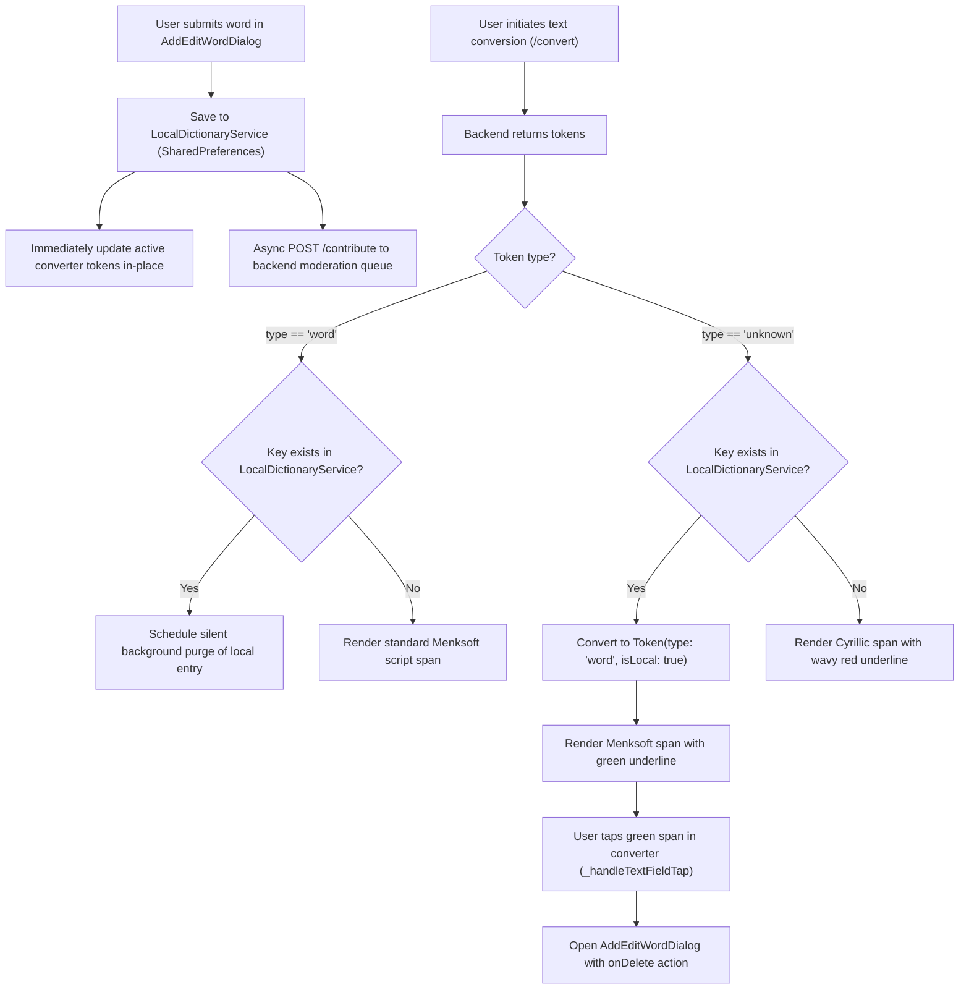

# Design Document: Local-First Word Persistence and Moderation Reconciliation

* **Author:** suragch
* **Date:** 2026-11-06
* **Status:** In Review

---

## 1. The Problem

In the Cyrillic Converter application, users regularly encounter Cyrillic words that have no Menksoft vertical script mapping in the central dictionary. When this occurs, the engine flags the token as `type: 'unknown'`. Users can click the flagged token to supply the Menksoft vertical script and submit the word for review via `AddEditWordDialog`.

Currently, this submission updates an ephemeral in-memory map (`_localOverrides`) within `_ConverterScreenState`. While this immediate update fixes the conversion output for the active session, all user-added definitions vanish as soon as the user reloads the browser, navigates away, or restarts the desktop client. Because moderation approval takes time, users are forced to repeatedly re-enter the same missing definitions or endure broken conversions while waiting for a moderator to act.

Furthermore, the existing prototype overwrites tokens regardless of whether the backend recognizes them, violating the invariant that the central dictionary remains the authoritative source of truth.

---

## 2. Overview

This design introduces a client-side persistent storage layer (`LocalDictionaryService` using `SharedPreferences`) that preserves user-contributed words across sessions on the user's device for all users, including anonymous visitors.

Key aspects of the system:
1. **Immediate Fallback Resolution**: When converting text, words stored locally resolve only unrecognized tokens (`type: 'unknown'`). The backend remains authoritative; locally saved words never override existing backend definitions.
2. **Visual Provenance and Direct Interaction**: Locally resolved words are rendered in green with a distinct dotted underline in the vertical text display. Clicking a green word opens `AddEditWordDialog` populated with the local definition, allowing the user to edit or delete the local definition directly from the converter.
3. **Conversion Reconciliation Silent Purge**: As soon as a moderator approves a word and the backend returns a recognized definition for that root during text conversion (`_convert()`), the client silently purges the local duplicate in the background.
4. **Dictionary Tab Management**: An integrated "Миний үгс" (My Words) section in the Dictionary navigation tab provides a centralized list where users can inspect, search, edit, and delete their locally stored words.
5. **Silent Rejection Model**: If a moderator rejects a submission, the local definition remains active for that user until they explicitly modify or delete it.

---

## 3. Goals and Non-Goals

### Goals
* **Session Persistence**: Retain user-added word definitions across browser reloads, page navigation, and desktop app restarts using client-side `SharedPreferences`.
* **Zero Latency Availability**: Make newly added words immediately usable for conversions on the authoring client without waiting for backend moderation.
* **Authoritative Central Dictionary**: Ensure that backend dictionary definitions always prevail over local definitions. Local words resolve only `type: 'unknown'` tokens.
* **Clear Provenance**: Visually differentiate locally resolved tokens using green text decoration in the converter view.
* **In-Situ and Central Management**: Allow users to edit or delete local definitions directly by tapping green words in the converter, or in bulk via a dedicated sub-view in the Dictionary tab.
* **Background Cleanup**: Automatically remove local entries once the backend officially incorporates the word.
* **Storage Protection**: Apply a soft ceiling without arbitrary numerical caps, catching platform storage quota exceptions dynamically while maintaining fast synchronous memory lookups.

### Non-Goals
* **Cross-Device Account Sync**: No server-side syncing of unapproved words across different devices or user accounts.
* **Local Overrides of Existing Words**: No capability for users to override verified words in the central dictionary.
* **Rejection Push Notifications**: No backend push notification system or rejection status tracking for anonymous submissions.
* **Export / Cloud Backup**: No cloud storage integration or external backup synchronization for the local dictionary.
* **Local Homonym Variant Lists**: Local dictionary entries support a single 1:1 Cyrillic-to-Menksoft mapping. Multi-variant homonym disambiguation is reserved for the curated central dictionary.

---

## 4. Technical Plan

### 4.1 System Architecture & Data Flow

The following sequence illustrates how a user-added word is persisted locally, utilized in conversions with green highlighting, submitted asynchronously to the moderation queue, and eventually purged once approved:



### 4.2 Data Model: `LocalWordEntry`

A data model `LocalWordEntry` will be defined in `frontend/lib/models/local_word_entry.dart`. Dead fields (`contextSnippet` and `isSynced`) are omitted to keep the model minimal and focused solely on conversion fallback:

```dart
import 'package:flutter/foundation.dart';

@immutable
class LocalWordEntry {
  final String cyrillic;
  final String menksoft;
  final String? explanation;
  final DateTime createdAt;

  const LocalWordEntry({
    required this.cyrillic,
    required this.menksoft,
    this.explanation,
    required this.createdAt,
  });

  Map<String, dynamic> toJson() => {
    'cyrillic': cyrillic,
    'menksoft': menksoft,
    if (explanation != null) 'explanation': explanation,
    'createdAt': createdAt.toIso8601String(),
  };

  factory LocalWordEntry.fromJson(Map<String, dynamic> json) => LocalWordEntry(
    cyrillic: json['cyrillic'] as String? ?? '',
    menksoft: json['menksoft'] as String? ?? '',
    explanation: json['explanation'] as String?,
    createdAt: DateTime.tryParse(json['createdAt'] as String? ?? '') ?? DateTime.now(),
  );

  LocalWordEntry copyWith({
    String? cyrillic,
    String? menksoft,
    String? explanation,
    DateTime? createdAt,
  }) => LocalWordEntry(
    cyrillic: cyrillic ?? this.cyrillic,
    menksoft: menksoft ?? this.menksoft,
    explanation: explanation ?? this.explanation,
    createdAt: createdAt ?? this.createdAt,
  );

  @override
  bool operator ==(Object other) =>
      identical(this, other) ||
      other is LocalWordEntry &&
          runtimeType == other.runtimeType &&
          cyrillic == other.cyrillic &&
          menksoft == other.menksoft &&
          explanation == other.explanation &&
          createdAt == other.createdAt;

  @override
  int get hashCode => Object.hash(cyrillic, menksoft, explanation, createdAt);
}
```

### 4.3 Service Architecture: `LocalDictionaryService`

A singleton service `LocalDictionaryService` (`frontend/lib/services/local_dictionary_service.dart`) extending `ChangeNotifier` manages in-memory state and disk persistence:

1. **In-Memory Cache**:
   - Maintains an internal `Map<String, LocalWordEntry> _entries` keyed by normalized Cyrillic root via `LatinIme.normalizeCyrillic` from `frontend/lib/services/latin_ime.dart`.
   - Synchronous $O(1)$ lookups during text conversion avoid asynchronous frame delays.
   - Maintains a pre-sorted cached `List<LocalWordEntry> _sortedWords` (sorted by `createdAt` descending) invalidated only on insertion or deletion, avoiding $O(N \log N)$ sorting on every UI build.
2. **Defensive Normalization**:
   - Every public method (`hasWord`, `getWord`, `addOrUpdateWord`, `deleteWord`, `purgeWords`) defensively invokes `LatinIme.normalizeCyrillic` internally, guaranteeing case-insensitive robustness regardless of caller formatting.
3. **Sequential Persistence Concurrency**:
   - Disk writes are serialized using a sequential `Future` chain (`_persistLock = _persistLock.then(...)`). In-memory updates remain synchronous, while disk operations execute in strict FIFO order, eliminating write races between concurrent conversion purges and user edits.
4. **API Contract**:
   ```dart
   Future<void> initialize();
   bool hasWord(String cyrillic);
   LocalWordEntry? getWord(String cyrillic);
   List<LocalWordEntry> get allWords;
   Future<bool> addOrUpdateWord({
     required String cyrillic,
     required String menksoft,
     String? explanation,
   });
   Future<void> deleteWord(String cyrillic);
   Future<void> purgeWords(Iterable<String> cyrillicWords);
   ```

### 4.4 Token Model and Controller Extensions

1. **`Token` Model (`frontend/lib/token.dart`)**:
   Add an optional `final bool isLocal;` (defaulting to `false`) to the `Token` class constructor. Because `Token` objects are received from the backend and never transmitted back over the network, `isLocal` is strictly a client-side runtime annotation; `toJson()` and `fromJson()` remain unmodified.
2. **Vertical Text Rendering (`frontend/lib/ui/converter_controller.dart`)**:
   In `MongolConverterController.buildTextSpan()`, evaluate `token.isLocal` before checking standard `token.type == 'word'` so that green styling is not shadowed:
   ```dart
   if (token.type == 'unknown') {
     // Red wavy underline span
   } else if (token.isLocal) {
     children.add(
       TextSpan(
         text: info.text,
         style: (style ?? const TextStyle()).copyWith(
           fontFamily: 'Menksoft',
           color: isHovered ? Colors.green.shade900 : Colors.green.shade800,
           backgroundColor: isHovered ? Colors.green.shade50 : null,
           decoration: TextDecoration.underline,
           decorationColor: Colors.green.shade700,
           decorationStyle: TextDecorationStyle.dotted,
         ),
       ),
     );
   } else if (token.type == 'word' && token.options.length > 1) {
     // Dashed blue homonym span
   } else if (token.type == 'word') {
     // Standard word span
   }
   ```

### 4.5 ConverterScreen Reconciliation Pipeline (`frontend/lib/main.dart`)

1. **Pure Token Resolution Helper**:
   Extract the reconciliation loop into a static pure function for testability:
   ```dart
   static List<Token> resolveLocalTokens({
     required List<Token> tokens,
     required LocalDictionaryService localService,
     required List<String> outRecognizedToPurge,
   }) {
     final result = List<Token>.from(tokens);
     for (var i = 0; i < result.length; i++) {
       final t = result[i];
       final norm = LatinIme.normalizeCyrillic(t.original);
       if (t.type == 'unknown') {
         final local = localService.getWord(norm);
         if (local != null) {
           result[i] = Token(
             type: 'word',
             original: t.original,
             isLocal: true,
             options: [
               TokenOption(
                 menksoft: local.menksoft,
                 isDefault: true,
                 explanation: local.explanation ?? 'Хувийн толь (Таны оруулсан хувилбар)',
               ),
             ],
           );
         }
       } else if (t.type == 'word') {
         if (localService.hasWord(norm)) {
           outRecognizedToPurge.add(norm);
         }
       }
     }
     return result;
   }
   ```
2. **Converter Ingestion & Silent Purge**:
   In `_convert()`, replace `_localOverrides` processing with:
   ```dart
   final recognizedToPurge = <String>[];
   final reconciled = ConverterScreen.resolveLocalTokens(
     tokens: parsed,
     localService: LocalDictionaryService.instance,
     outRecognizedToPurge: recognizedToPurge,
   );
   // update state with reconciled tokens...
   if (recognizedToPurge.isNotEmpty) {
     unawaited(LocalDictionaryService.instance.purgeWords(recognizedToPurge));
   }
   ```
3. **Gesture Dispatch Alignment & Branching Precedence**:
   In `_handleTextFieldTap()` (line 648) and `_handleSecondaryTap()` (line 674), check `if (token.isLocal)` **before** `if (token.type == 'word')`:
   ```dart
   if (token.isLocal) {
     _showLocalWordDialog(token, tokenIndex: info.tokenIndex);
   } else if (token.type == 'unknown') {
     _showFixDialog(token, tokenIndex: info.tokenIndex);
   } else if (token.type == 'word') {
     // homonym or word action menu
   }
   ```
4. **Reusing `AddEditWordDialog` with Delete**:
   Opening `_showLocalWordDialog` passes `onDelete`:
   ```dart
   void _showLocalWordDialog(Token token, {int? tokenIndex}) {
     final norm = LatinIme.normalizeCyrillic(token.original);
     final local = LocalDictionaryService.instance.getWord(norm);
     showDialog(
       context: context,
       builder: (ctx) => AddEditWordDialog(
         title: 'Хувийн толь: "${token.original}"',
         initialCyrillic: token.original,
         initialLatin: local?.menksoft != null ? LatinIme.convertToLatin(local!.menksoft) : null,
         initialExplanation: local?.explanation,
         submitButtonText: 'Хадгалах',
         onDelete: () async {
           await LocalDictionaryService.instance.deleteWord(norm);
           if (mounted) {
             _convert(force: true);
           }
         },
         onSubmit: ({required cyrillic, required menksoft, context, explanation}) async {
           await LocalDictionaryService.instance.addOrUpdateWord(
             cyrillic: cyrillic,
             menksoft: menksoft,
             explanation: explanation,
           );
           if (mounted) {
             _convert(force: true);
           }
         },
       ),
     );
   }
   ```
5. **Footer Status Legend**:
   In `_buildConverterWorkspace()`, add a green legend indicator when local words are present:
   ```dart
   if (_tokens.any((t) => t.isLocal)) ...[
     _buildLegendDot(color: Colors.green.shade700, label: 'Хувийн толь'),
   ],
   ```

### 4.6 Dictionary Tab Management Interface (`frontend/lib/ui/dictionary/dictionary_browse_view.dart`)

1. **Sub-Navigation Control**:
   A segmented tab header at the top of `DictionaryBrowseView`:
   - `Бүх нийтийн толь` (Public Dictionary Search — existing view).
   - `Миний үгс (${localWords.length})` (My Words).
2. **"Миний үгс" View Panel**:
   - **Search Input**: Filters local entries dynamically by Cyrillic root or explanation.
   - **Empty State**: Prompt explaining that words added via the converter will appear here until approved by moderators.
   - **Word Cards**:
     - Cyrillic title in bold with Latin transliteration subtitle.
     - Vertical Mongolian script preview rendered via `MongolText` from `package:mongol/mongol.dart`.
     - Creation date string.
     - Action buttons: "Засах" (opens `AddEditWordDialog` pre-filled) and "Устгах" (deletes with confirmation).

---

## 5. Alternatives Considered

### 5.1 Retaining the Ephemeral In-Memory Map (Current State)
* **Description**: Keep the existing `_localOverrides` map in `_ConverterScreenState`.
* **Reason for Rejection**: The in-memory map loses all state upon browser page reload, navigation, or app restart. Users are forced to re-enter definitions every session while waiting for moderator review, creating user friction.

### 5.2 Server-Side Per-User Dictionary Overlay
* **Description**: Store unapproved user words in PocketBase or SQLite on the backend associated with a user ID or session ID, joining against user-specific tables during `/convert`.
* **Reason for Rejection**: This approach requires mandatory user authentication and excludes anonymous public users. It also introduces per-request database joins into the high-throughput `/convert` path, adding latency and cache invalidation complexity to the server.

### 5.3 Local Precedence Over Backend (User Override Mode)
* **Description**: Allow a user's locally stored word to override an existing backend dictionary entry if both exist.
* **Reason for Rejection**: The central dictionary is curated and vetted by native language moderators. Allowing unverified local entries to override official dictionary entries risks propagating typos, colloquial variants, and incorrect homonym disambiguations into standard conversion results. The backend must remain the authoritative source of truth.

### 5.4 SQLite Local Storage via `sqflite` and `sqlite3.wasm`
* **Description**: Use a local SQLite database for client-side storage instead of `SharedPreferences`.
* **Reason for Rejection**: The frontend explicitly targets Flutter Web alongside Desktop and Mobile. Running SQLite on Flutter Web requires WebAssembly (`sqlite3.wasm`), web worker threads, and specialized cross-origin headers (COOP/COEP). Because personal word lists rarely exceed several hundred entries (~100 KB total), `SharedPreferences` delivers synchronous $O(1)$ memory lookups with zero WebAssembly build overhead.

### 5.5 Hard 500-Word Storage Limit
* **Description**: Block word additions once the local collection reaches 500 entries.
* **Reason for Rejection**: A 500-entry JSON payload consumes only ~100 KB, which is approximately 2% of the standard 5 MB browser `localStorage` quota. Imposing an artificial numerical hard limit introduces friction for prolific contributors. Adopting a soft ceiling that catches platform quota exceptions dynamically provides safety without artificial constraints.

### 5.6 Stateful Rejection Tracking and Polling
* **Description**: Provide an endpoint where clients poll the approval or rejection status of each submitted suggestion ID.
* **Reason for Rejection**: Tracking submissions for anonymous users requires device fingerprinting or persistent server sessions. Adding rejection status APIs adds backend surface area for minimal utility. Accepting silent rejection—where unapproved words remain local until manually deleted—respects user autonomy without backend overhead.

### 5.7 Speculative Offline Sync Queue and Replay Subsystem
* **Description**: Track an `isSynced` flag, retry queue, network connectivity pollers, and sync state badges for offline word submissions.
* **Reason for Rejection**: Text conversion (`/convert`) strictly requires an online network connection; users cannot convert text offline. Tracking persistent sync states introduces dead code, startup polling overhead, and desynchronization bugs when users edit words locally. Asynchronous `POST /contribute` is already dispatched best-effort during addition.

### 5.8 Separate `EditLocalWordDialog` Widget
* **Description**: Create a standalone dialog file `frontend/lib/ui/dialogs/edit_local_word_dialog.dart` for local word editing.
* **Reason for Rejection**: The existing `AddEditWordDialog` already provides ~678 lines of mature virtual keyboard, IME Latin transliteration, and preview logic. Duplicating it creates maintenance overhead and visual divergence. Adding an optional `onDelete` parameter to `AddEditWordDialog` achieves the exact same functionality with minimal code.

### 5.9 Local Multi-Option Homonym Lists
* **Description**: Support multiple Menksoft candidates per Cyrillic word in local storage.
* **Reason for Rejection**: Cyrillic homonym disambiguation requires semantic rule tagging and candidate ranking. Introducing multi-option candidate management into the client local store inflates data models and UI complexity. A 1:1 mapping satisfies personal conversion fixes while keeping client storage minimal.

---

## 6. Detailed Implementation Plan

### 6.1 Enumerate Files Touched

| File Path | Action | Rationale |
| --- | --- | --- |
| `frontend/lib/models/local_word_entry.dart` | Create | Immutable model representing a local dictionary entry (`cyrillic`, `menksoft`, `explanation`, `createdAt`) with equality operators and JSON serialization. |
| `frontend/lib/services/local_dictionary_service.dart` | Create | Reactive `ChangeNotifier` singleton holding in-memory entries for synchronous $O(1)$ lookups, cached sorted list, defensive normalization, and sequential Future-chained `SharedPreferences` persistence. |
| `frontend/lib/token.dart` | Modify | Extends `Token` with an optional runtime `final bool isLocal;` (default `false`) so UI layers recognize locally resolved tokens. |
| `frontend/lib/ui/converter_controller.dart` | Modify | Styles vertical text spans for tokens where `isLocal == true` with Menksoft script, dotted green underline (`Colors.green.shade700`), and green hover background. |
| `frontend/lib/ui/dialogs/add_edit_word_dialog.dart` | Modify | Adds an optional `Future<void> Function()? onDelete` callback and renders an "Устгах" action button when supplied. |
| `frontend/lib/main.dart` | Modify | Imports `dart:async`; initializes `LocalDictionaryService`; replaces `_localOverrides` with pure `ConverterScreen.resolveLocalTokens`; schedules background silent purge; checks `token.isLocal` first in tap handlers; adds green legend dot to footer status bar. |
| `frontend/lib/ui/dictionary/dictionary_browse_view.dart` | Modify | Introduces a segmented tab control (`Бүх нийтийн толь` vs. `Миний үгс`); renders local word cards with search filtering, empty states, and edit/delete actions via `AddEditWordDialog`. |
| `frontend/test/local_dictionary_service_test.dart` | Create | Unit tests validating `LocalDictionaryService` initialization, normalization, upsert, deletion, batch silent purge, and write error handling. |
| `frontend/test/converter_local_tokens_test.dart` | Create | Pure unit tests verifying `ConverterScreen.resolveLocalTokens` unknown token fallback and backend priority over local entries. |
| `frontend/lib/README.md` | Modify | Documents `LocalDictionaryService` and local word token flow. |
| `frontend/lib/services/README.md` | Modify | Documents `LocalDictionaryService` API contract and sequential persistence guarantees. |
| `frontend/lib/ui/README.md` | Modify | Documents the green styling token contract and local word gesture interactions. |
| `frontend/lib/ui/dialogs/README.md` | Modify | Documents the `onDelete` parameter in `AddEditWordDialog`. |
| `frontend/lib/ui/dictionary/README.md` | Modify | Documents the "Миний үгс" segmented sub-navigation and local word card management in `DictionaryBrowseView`. |

---

### 6.2 Step-by-Step Execution Sequence

#### Step 1: Model Definition (`frontend/lib/models/local_word_entry.dart`)
1. Create `LocalWordEntry` class with fields:
   - `cyrillic` (`String`)
   - `menksoft` (`String`)
   - `explanation` (`String?`)
   - `createdAt` (`DateTime`)
2. Implement `toJson()` and `fromJson()` with fallback handling for malformed data.
3. Implement `operator ==` and `hashCode` using `Object.hash`.
4. Implement `copyWith(...)`.

#### Step 2: Storage Service Implementation (`frontend/lib/services/local_dictionary_service.dart`)
1. Implement `LocalDictionaryService` as a singleton extending `ChangeNotifier`.
2. Maintain internal state:
   - `Map<String, LocalWordEntry> _entries = {}`
   - `List<LocalWordEntry> _sortedWords = []`
   - `Future<void> _persistLock = Future.value()`
   - `bool _isInitialized = false`
3. Implement `initialize()`:
   - Read JSON string from `SharedPreferences` key `'cyrillic_converter_local_words'`.
   - Decode into `_entries`, re-sort `_sortedWords`, set `_isInitialized = true`, and call `notifyListeners()`.
4. Implement `List<LocalWordEntry> get allWords => List.unmodifiable(_sortedWords)`.
5. Implement defensive key access:
   - In `hasWord(String cyrillic)` and `getWord(String cyrillic)`, normalize key via `LatinIme.normalizeCyrillic(cyrillic)`.
6. Implement `addOrUpdateWord({required String cyrillic, required String menksoft, String? explanation})`:
   - Normalize key, update `_entries`, rebuild `_sortedWords`.
   - Enqueue sequential persistence via `_persist()`.
   - Call `notifyListeners()`.
7. Implement `deleteWord(String cyrillic)`:
   - Normalize key, remove from `_entries`, rebuild `_sortedWords`, enqueue `_persist()`, call `notifyListeners()`.
8. Implement `purgeWords(Iterable<String> cyrillicWords)`:
   - Filter `_entries` removing matching normalized keys, rebuild `_sortedWords`, enqueue `_persist()`, call `notifyListeners()`.
9. Implement `_persist()` with sequential `_persistLock` chaining to eliminate write races. Catch quota exceptions dynamically and return `false`.

#### Step 3: Token Model Extension (`frontend/lib/token.dart`)
1. Add `final bool isLocal;` (default `false`) to `Token` constructor.
2. Leave `toJson()` and `fromJson()` unmodified.

#### Step 4: Vertical Text Styling (`frontend/lib/ui/converter_controller.dart`)
1. In `MongolConverterController.buildTextSpan()`, add branch for `token.isLocal` placed immediately after `token.type == 'unknown'` and before `token.type == 'word'`.
2. Apply `fontFamily: 'Menksoft'`, `color: isHovered ? Colors.green.shade900 : Colors.green.shade800`, `backgroundColor: isHovered ? Colors.green.shade50 : null`, and dotted underline (`Colors.green.shade700`).

#### Step 5: Extend `AddEditWordDialog` (`frontend/lib/ui/dialogs/add_edit_word_dialog.dart`)
1. Add optional `final Future<void> Function()? onDelete;` parameter to `AddEditWordDialog`.
2. When `onDelete != null`, render an "Устгах" (Delete) outlined text button with red accent color in the dialog action bar alongside the cancel and submit buttons.
3. Show confirmation dialog before executing `onDelete`.

#### Step 6: Converter Screen Integration (`frontend/lib/main.dart`)
1. Add `import 'dart:async';` to `frontend/lib/main.dart`.
2. In `_ConverterScreenState.initState()`, call `LocalDictionaryService.instance.initialize()`.
3. Add static pure helper `ConverterScreen.resolveLocalTokens(...)`.
4. In `_convert()`, replace `_localOverrides` logic by calling `resolveLocalTokens(...)`. If recognized words matched local keys, call `unawaited(LocalDictionaryService.instance.purgeWords(recognizedToPurge))`.
5. Remove `final Map<String, String> _localOverrides`.
6. In `_handleWordAddedOrSuggested()`, replace `_localOverrides` assignment with `LocalDictionaryService.instance.addOrUpdateWord(...)`.
7. In `_handleTextFieldTap()` and `_handleSecondaryTap()`, check `if (token.isLocal)` as the first branch before `if (token.type == 'word')`, opening `_showLocalWordDialog()`.
8. In `_showLocalWordDialog()`, wire `onDelete` to delete from service and trigger `_convert(force: true)`, and wire `onSubmit` to save to service and trigger `_convert(force: true)`.
9. In `_buildConverterWorkspace()`, add a green dot legend item for "Хувийн толь" when `_tokens.any((t) => t.isLocal)`.

#### Step 7: Dictionary Tab View (`frontend/lib/ui/dictionary/dictionary_browse_view.dart`)
1. Add segmented sub-navigation button or tab bar at top of `DictionaryBrowseView`:
   - `Бүх нийтийн толь` (Public central dictionary search).
   - `Миний үгс (${localService.allWords.length})` (Local words).
2. Use `ListenableBuilder` listening to `LocalDictionaryService.instance`.
3. When `Миний үгс` is selected:
   - Provide a search text field filtering local entries by Cyrillic or explanation.
   - Render cards showing Cyrillic title, Latin transliteration, vertical Menksoft script preview (`MongolText`), creation date, and Edit/Delete buttons.
   - Clicking Edit opens `AddEditWordDialog` pre-filled.
   - Clicking Delete opens confirmation dialog and calls `LocalDictionaryService.instance.deleteWord(...)`.
   - Render clean empty state when no local words exist.

#### Step 8: Unit Testing
1. Create `frontend/test/local_dictionary_service_test.dart`:
   - Test JSON serialization and deserialization with corrupted data fallback.
   - Test defensive Cyrillic normalization across uppercase/lowercase inputs.
   - Test cached `allWords` ordering by `createdAt` descending.
   - Test sequential write concurrency via `_persistLock`.
   - Test batch `purgeWords()` removing only targeted keys.
2. Create `frontend/test/converter_local_tokens_test.dart`:
   - Unit test pure function `ConverterScreen.resolveLocalTokens`:
     - Unknown tokens matching local entries are flagged `isLocal: true`.
     - Central dictionary `type: 'word'` tokens take strict priority over local entries.
     - Central matches are correctly collected into `outRecognizedToPurge`.

#### Step 9: Quality Assurance & Verification
1. Run `dart format frontend/` to ensure formatting compliance.
2. Run `cd frontend && flutter analyze --fatal-infos` to guarantee zero warnings or lints.
3. Run `cd frontend && flutter test` to ensure all tests pass.
4. Update documentation in:
   - `frontend/lib/README.md`
   - `frontend/lib/services/README.md`
   - `frontend/lib/ui/README.md`
   - `frontend/lib/ui/dialogs/README.md`
   - `frontend/lib/ui/dictionary/README.md`
