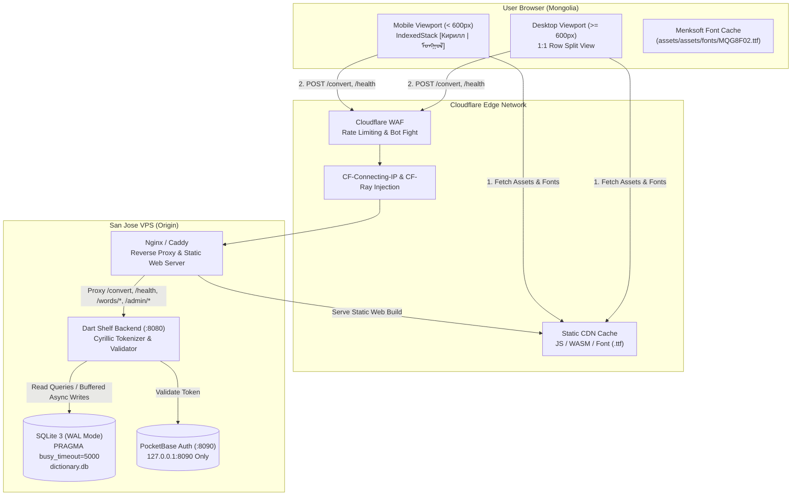

# Public Web Release Readiness: Cyrillic to Traditional Mongolian Converter

* **Author:** suragch
* **Status:** Ready for Implementation
* **Date:** 2026-11-02
* **Target Components:** [`frontend/`](file:///Users/suragch/Dev/FlutterProjects/cyrillicconverter/frontend/), [`backend/`](file:///Users/suragch/Dev/FlutterProjects/cyrillicconverter/backend/), [`deploy/`](file:///Users/suragch/Dev/FlutterProjects/cyrillicconverter/deploy/)

---

## Overview

The Cyrillic to Traditional Mongolian Converter is a suite designed to convert modern Cyrillic Mongolian into Traditional Mongolian vertical script (`ᠮᠣᠩᠭᠣᠯ ᠪᠢᠴᠢᠭ`), resolve homonyms, allow dictionary lookup, and crowd-source missing vocabulary with moderator verification. 

This design document outlines the technical changes required to prepare the system for a public web launch. The system consists of a Flutter Web frontend and a Dart Shelf backend with SQLite 3 (in Write-Ahead Logging mode) hosted on a single VPS in San Jose behind Cloudflare. The primary user base is located in Mongolia, connecting over a trans-Pacific network link with 180–250ms round-trip latency.

---

## The Problem

The current codebase was developed and styled primarily for a desktop workstation environment. Releasing it directly to the public web in its current state introduces four critical failure modes:

1. **Mobile Viewport Collapse**: On desktop screens, the workspace renders as a side-by-side `Row` with equal 1:1 split ([`frontend/lib/main.dart#L1219-L1229`](file:///Users/suragch/Dev/FlutterProjects/cyrillicconverter/frontend/lib/main.dart#L1219-L1229)). On viewports under 800px, it falls back to a vertical `Column` (`flex: 4` for Cyrillic and `flex: 6` for Mongolian). When an on-screen virtual keyboard opens on mobile browsers, vertical space collapses to ~34px, triggering fatal Flutter `RenderFlex` overflow errors and rendering the application unusable on smartphones.
2. **SQLite Lock Contention Crashes**: In [`backend/lib/database.dart`](file:///Users/suragch/Dev/FlutterProjects/cyrillicconverter/backend/lib/database.dart), WAL mode is active, but `PRAGMA busy_timeout` is not set (defaulting to 0ms). Furthermore, synchronous writes for unrecognized word telemetry (`unknown_logs`) are embedded directly in the conversion read loop ([`backend/bin/server.dart#L254-L260`](file:///Users/suragch/Dev/FlutterProjects/cyrillicconverter/backend/bin/server.dart#L254-L260)). Concurrent conversions or simultaneous moderator actions trigger immediate `SqliteException (error code 5): database is locked` exceptions, returning HTTP 500 errors to users.
3. **High Latency & Font Loading Failures**: Downloading the 8–12MB Flutter Web engine and the Menksoft vertical font (`MQG8F02.ttf`) over trans-Pacific connections causes a 5–10 second blank white screen on first load. If font delivery is interrupted or delayed, vertical Mongolian glyphs render as broken tofu boxes.
4. **Reverse Proxy & Route Misalignment**: Deploying the backend behind a reverse proxy that routes only `/api/*` will break the client, because [`frontend/lib/main.dart`](file:///Users/suragch/Dev/FlutterProjects/cyrillicconverter/frontend/lib/main.dart) and [`backend/bin/server.dart`](file:///Users/suragch/Dev/FlutterProjects/cyrillicconverter/backend/bin/server.dart) query root paths directly (`/convert`, `/health`, `/words/*`).

---

## Goals

* **Mobile-Responsive Web Layout (< 600px)**: Provide a responsive mobile interface using a segmented two-tab toggle (`[ Кирилл | ᠮᠣᠩᠭᠣᠯ ]`) that avoids `RenderFlex` overflows, preserves user input and scroll positions via `IndexedStack`, and dismisses virtual keyboards cleanly upon conversion.
* **Touch-Friendly Token Interaction**: Implement touch-appropriate contextual interactions using `showModalBottomSheet` for selecting homonym alternatives, displaying Menksoft vertical previews and Latin transliterations via [`LatinIme.menksoftToLatin`](file:///Users/suragch/Dev/FlutterProjects/cyrillicconverter/frontend/lib/services/latin_ime.dart#L36).
* **Database Concurrency Defense**: Eliminate database-locked crashes during concurrent requests by configuring a 5000ms SQLite busy timeout and decoupling telemetry logging from the critical conversion read path.
* **Trans-Pacific Delivery & Caching**: Eliminate initial blank screens and font rendering failures through an inline HTML/CSS splash loader, preloading `assets/assets/fonts/MQG8F02.ttf`, and applying immutable edge caching headers.
* **Cloudflare Client IP & Session Deduplication**: Extract verified visitor IP addresses from `CF-Connecting-IP` combined with `X-Session-ID` to protect deduplication structures without colliding on mobile Carrier-Grade NAT (CGNAT) networks.
* **Fault-Tolerant Client Network Requests**: Guard all network calls with explicit timeouts (15s conversion, 6s health check) and actionable error recovery banners in Mongolian.

---

## Non-Goals

* **Native Mobile Applications**: Developing, packaging, or distributing native iOS or Android app binaries is out of scope for this release.
* **Client-Side In-Browser Database**: Porting the dictionary database to client-side WebAssembly storage (e.g., sql.js or Drift in browser) is excluded.
* **Automated Cloud Backup Infrastructure**: Implementing automated S3/R2 remote backup sync pipelines is deferred; manual authenticated snapshots (`/admin/db/download`) and public CSV/JSON exports remain the launch baseline.
* **Custom Backend Rate Limiting Daemons**: Building custom token-bucket or Redis-backed rate limiting services in Dart Shelf is excluded; connection throttling is delegated to Cloudflare WAF.

---

## Open Questions

* *None. All architectural questions resolved:*
  - **Question 1 (Resolved)**: Mobile layout (< 600px) uses a segmented two-tab toggle (`[ Кирилл | ᠮᠣᠩᠭᠣᠯ ]`), switching view focus to the output tab upon successful conversion while preserving state with `IndexedStack`.
  - **Question 2 (Resolved)**: PocketBase (port 8090) is strictly bound to `127.0.0.1` on the VPS localhost and is not publicly exposed through Cloudflare or reverse proxy.
  - **Question 3 (Resolved)**: Reverse proxy routes top-level API endpoints (`/convert`, `/contribute`, `/health`, `/words/*`, `/admin/*`, `/auth/*`, `/export/*`) to Shelf on port 8080 and serves static frontend web assets for all other paths.

---

## Critical User Journeys (CUJs)

### CUJ 1: Public Visitor Converts Cyrillic Text on a Mobile Phone
* **Given**: A user in Ulaanbaatar visits the web application using Safari or Chrome on a smartphone over a cellular 4G connection.
* **When**: The user loads the page, views the inline splash spinner until Flutter attaches, types or pastes a Cyrillic sentence into the input field (activating the software keyboard), and taps "Хөрвүүлэх" (Convert).
* **Then**: The software keyboard dismisses, the view switches to the Mongolian tab via `IndexedStack`, and the vertical text renders correctly with Menksoft fonts within 1 second.

### CUJ 2: Public Visitor Disambiguates a Homonym on a Touchscreen
* **Given**: A converted text contains an ambiguous word highlighted with a dashed indicator.
* **When**: The user taps the ambiguous word on their touchscreen.
* **Then**: The application opens a modal bottom sheet displaying candidate Traditional Mongolian words with Menksoft vertical preview, Latin transliteration, and definitions, allowing selection with a single tap (minimum 48×48px target).

### CUJ 3: Public Visitor Contributes a Missing Word
* **Given**: A converted text contains an unrecognized word highlighted with a wavy red indicator.
* **When**: The user taps the unknown word and selects "Үг нэмэх" (Add Word) to suggest a translation.
* **Then**: The dialog presents inputs for Cyrillic spelling and Latin transliteration, adapts to the mobile screen without overflow, respects virtual keyboard insets, and submits the suggestion to `/contribute`.

### CUJ 4: Concurrent Traffic with Moderator Review
* **Given**: Multiple public users submit conversion requests simultaneously while a moderator approves community suggestions in the Moderator Station.
* **When**: Database writes occur concurrently on `unknown_logs`, `suggestions`, and `words`.
* **Then**: The backend handles write serialization gracefully using SQLite WAL mode, decoupled background telemetry, and a 5,000ms busy timeout without throwing database-locked errors.

---

## Technical Plan (Architecture)

### 1. Architectural System Overview

The system partitions into three tiers: the Cloudflare Edge, the Flutter Web client, and the Dart Shelf backend with SQLite/PocketBase on the VPS.



---

### 2. Frontend Subsystem Changes ([`frontend/`](file:///Users/suragch/Dev/FlutterProjects/cyrillicconverter/frontend/))

#### 2.1 Responsive Converter Workspace Layout
In [`frontend/lib/main.dart`](file:///Users/suragch/Dev/FlutterProjects/cyrillicconverter/frontend/lib/main.dart) (`_buildConverterWorkspace`):
* Replace the rigid layout check with a responsive threshold: `final isMobile = MediaQuery.sizeOf(context).width < 600;`.
* **Desktop Mode (`width >= 600`)**: Preserves the existing side-by-side `Row` layout (equal 1:1 `flex: 1` split: `Expanded(child: _buildCyrillicSourcePane(isMobile: false))` and `Expanded(child: _buildMongolianOutputPane(isMobile: false))`), the desktop header tabs, and status bar.
* **Mobile Mode (`width < 600`)**:
  * Render a top `SegmentedButton<int>` with segments:
    - Segment 0: `'Кирилл бичих'`
    - Segment 1: `convertUnicodeToMenksoft('ᠮᠣᠩᠭᠣᠯ') + ' бичиг'` (ensuring correct Menksoft PUA rendering).
  * Use `IndexedStack(index: _mobileSelectedTab, children: [_buildCyrillicSourcePane(isMobile: true), _buildMongolianOutputPane(isMobile: true)])` to preserve text selection, cursor position, and horizontal scroll position on the vertical canvas across tab toggles.
  * In `_buildCyrillicSourcePane(isMobile: true)`: Render a full-width "Хөрвүүлэх" action button at the bottom of the input container.
  * In `_buildMongolianOutputPane(isMobile: true)`: Render a bottom action bar with "Засах" (switches `_mobileSelectedTab = 0`), "Хуулах" (copies text), and conversion token metrics (homonym count, unknown word count).
  * Hide the 28px `DesktopStatusBar` on mobile screens (`< 600px`). Cyrillic input metrics (character count, word count) are displayed directly in the input footer.
  * Wrap the root `Scaffold` body in `SafeArea` to prevent notch and navigation gesture clipping.

#### 2.2 Top Header Adaptation on Mobile
In [`frontend/lib/main.dart`](file:///Users/suragch/Dev/FlutterProjects/cyrillicconverter/frontend/lib/main.dart) (`DesktopHeader`):
* When `MediaQuery.sizeOf(context).width < 600`:
  * Wrap navigation items in a horizontally scrollable container (`SingleChildScrollView(scrollDirection: Axis.horizontal)`).
  * Hide administrative/moderator navigation links for unauthenticated public visitors.
  * Keep the brand title and login/settings controls accessible without triggering horizontal layout overflow.

#### 2.3 Software Keyboard & Touch Ergonomics
In [`frontend/lib/main.dart`](file:///Users/suragch/Dev/FlutterProjects/cyrillicconverter/frontend/lib/main.dart):
* Call `FocusScope.of(context).unfocus()` when tapping "Хөрвүүлэх" or toggling tabs to dismiss the on-screen keyboard, preventing it from obscuring the vertical script canvas.
* Adapt `DesktopDialogFrame`: Constrain width to `BoxConstraints(maxWidth: math.min(520.0, MediaQuery.sizeOf(context).width - 32.0))` and add padding for `MediaQuery.viewInsetsOf(context).bottom` to ensure action buttons remain visible above the software keyboard.
* On token ambiguity disambiguation:
  - Coordinate mapping: Map touch coordinates to character offsets on `MongolTextField` via `MongolRenderEditable`.
  - Use `showModalBottomSheet`: Present candidate cards horizontally with minimum 48×48px touch targets, showing Menksoft vertical preview, Latin transliteration via [`LatinIme.menksoftToLatin(option.menksoft)`](file:///Users/suragch/Dev/FlutterProjects/cyrillicconverter/frontend/lib/services/latin_ime.dart#L36), and definition text.

#### 2.4 Network Resilience & Timeouts
In [`frontend/lib/main.dart`](file:///Users/suragch/Dev/FlutterProjects/cyrillicconverter/frontend/lib/main.dart) (`_convert` and `_checkServerHealth`):
* Configure `http.post('/convert')` with `.timeout(const Duration(seconds: 15))`.
* Verify `if (mounted)` before checking `MediaQuery` or executing `setState`.
* On timeout or socket exception, display a localized Mongolian retry banner:
  > `'Сүлжээний алдаа гарлаа. Дахин оролдоно уу.'` ("Network error occurred. Please retry.")
* Extend the startup health check timeout in `_checkServerHealth()` from 3s to 6s to accommodate cold TLS handshakes over trans-Pacific connections.

---

### 3. Backend Subsystem Changes ([`backend/`](file:///Users/suragch/Dev/FlutterProjects/cyrillicconverter/backend/))

#### 3.1 SQLite Concurrency & Decoupled Telemetry
In [`backend/lib/database.dart`](file:///Users/suragch/Dev/FlutterProjects/cyrillicconverter/backend/lib/database.dart) & [`backend/bin/server.dart`](file:///Users/suragch/Dev/FlutterProjects/cyrillicconverter/backend/bin/server.dart):
* Add `db.execute('PRAGMA busy_timeout = 5000;');` in `AppDatabase.open` immediately after enabling WAL mode.
* Decouple unknown word logging: Instead of performing synchronous SQLite write queries inside the `/convert` read loop, queue unrecognized words in an in-memory buffer and flush them to `unknown_logs` asynchronously in background batches. This ensures `/convert` read requests never contend for write locks with moderator operations.

#### 3.2 Client Identification & Guarded Deduplication
In [`backend/bin/server.dart`](file:///Users/suragch/Dev/FlutterProjects/cyrillicconverter/backend/bin/server.dart):
* Implement `_getClientIp(Request request)` with resolution precedence:
  1. `request.headers['cf-connecting-ip']` (injected by Cloudflare).
  2. `request.headers['x-forwarded-for']` (first comma-separated IP).
  3. Fallback: `'anonymous'`.
* Construct composite client keys:
  ```dart
  final sessionId = request.headers['x-session-id']?.trim();
  final clientIp = _getClientIp(request);
  final clientKey = sessionId != null && sessionId.isNotEmpty
      ? '$clientIp:$sessionId'
      : clientIp;
  ```
  This preserves multi-client testing in `server_test.dart` and avoids deduplicating independent cellular users sharing carrier CGNAT IP addresses.
* Key `_recentUnknownWordLogs` on `'$clientKey:$normalizedCyrillic'`.
* Guard FIFO cache eviction:
  ```dart
  if (!_recentUnknownWordLogs.containsKey(cacheKey)) {
    if (_recentUnknownWordLogs.length >= 5000) {
      _recentUnknownWordLogs.remove(_recentUnknownWordLogs.keys.first);
    }
    _recentUnknownWordLogs[cacheKey] = now;
  }
  ```

#### 3.3 HTTP Payload Limit & Health Check Liveness
In [`backend/bin/server.dart`](file:///Users/suragch/Dev/FlutterProjects/cyrillicconverter/backend/bin/server.dart):
* Lower `maxBytes` in `payloadLimitMiddleware` from 10MB to 512KB (`512 * 1024`).
* Format the payload limit error message in KB to prevent integer division truncation:
  ```dart
  'Payload exceeds maximum limit of ${maxBytes ~/ 1024}KB'
  ```
* In `_healthHandler`, execute `_db.db.select('SELECT 1;')` in a try/catch block. Return HTTP 200 with `{"status": "ok"}` on success; return HTTP 503 with `{"status": "unavailable"}` if SQLite throws.

---

### 4. Infrastructure & Web Asset Delivery ([`frontend/web/`](file:///Users/suragch/Dev/FlutterProjects/cyrillicconverter/frontend/web/))

#### 4.1 Inline Splash Loader & Font Preloading
In [`frontend/web/index.html`](file:///Users/suragch/Dev/FlutterProjects/cyrillicconverter/frontend/web/index.html):
* Add the preloading tag for the Menksoft vertical font using Flutter Web's asset bundle path:
  ```html
  <link rel="preload" href="assets/assets/fonts/MQG8F02.ttf" as="font" type="font/ttf" crossorigin>
  ```
* Insert an inline CSS spinner and branding container into the `<body>`:
  ```html
  <div id="splash">
    <div class="splash-spinner"></div>
    <div class="splash-title">Кирилл - Монгол бичиг хөрвүүлэгч</div>
  </div>
  <style>
    #splash {
      position: fixed; top: 0; left: 0; width: 100%; height: 100%;
      display: flex; flex-direction: column; align-items: center; justify-content: center;
      background: #f8f9fa; z-index: 9999; transition: opacity 0.4s ease-out;
    }
    #splash.fade-out { opacity: 0; pointer-events: none; }
    .splash-spinner {
      width: 44px; height: 44px; border: 4px solid #e2e8f0;
      border-top-color: #2563eb; border-radius: 50%;
      animation: splash-spin 0.8s linear infinite;
    }
    .splash-title { margin-top: 16px; font-family: sans-serif; font-size: 16px; color: #475569; }
    @keyframes splash-spin { to { transform: rotate(360deg); } }
  </style>
  ```
* In `flutter_bootstrap.js` (or inline bootstrap script), dismiss and remove `#splash` when the Flutter canvas attaches:
  ```javascript
  _flutter.loader.load({
    onEntrypointLoaded: async function(engineInitializer) {
      const appRunner = await engineInitializer.initializeEngine();
      await appRunner.runApp();
      const splash = document.getElementById('splash');
      if (splash) {
        splash.classList.add('fade-out');
        setTimeout(() => splash.remove(), 400);
      }
    }
  });
  ```

#### 4.2 Reverse Proxy Routing & Edge Caching
* **Reverse Proxy Contract**: Nginx or Caddy on the VPS proxies top-level backend API paths to Shelf on `127.0.0.1:8080`:
  - `/convert`, `/contribute`, `/health`, `/words/*`, `/admin/*`, `/auth/*`, `/export/*` → `http://127.0.0.1:8080`
  - All other paths (`/`, `/assets/*`, `*.wasm`, `*.js`) are served directly from the static Flutter Web release directory (`frontend/build/web/`).
* **Cache-Control Headers**:
  - `index.html` and `flutter_bootstrap.js`: `Cache-Control: no-cache, no-store, must-revalidate`
  - `assets/assets/fonts/MQG8F02.ttf`, `*.wasm`, `*.js`: `Cache-Control: public, max-age=31536000, immutable`

---

## Risks & Mitigations

| Risk | Impact | Concrete Mitigation |
| :--- | :--- | :--- |
| **Single-VPS Origin Downtime** | Web application and API become unavailable if the San Jose VPS crashes. | systemd service automatically restarts Shelf and PocketBase on failure; Cloudflare edge continues serving static web assets and returns an actionable maintenance page. |
| **SQLite WAL Lock Contention** | Concurrent writes cause `database is locked` HTTP 500 errors. | 1) `PRAGMA busy_timeout = 5000;` delays locks up to 5s. 2) Telemetry writes (`unknown_logs`) are decoupled from conversion read requests into an async background queue. |
| **Trans-Pacific Network Latency (180–250ms)** | High round-trip time causes slow conversions and initial white screen. | 1) Menksoft font preloaded in `<head>`. 2) Static bundles cached permanently on Cloudflare edge. 3) Unified origin eliminates cross-origin `OPTIONS` preflight requests. 4) Client timeout set to 15s with retry banner. |
| **CGNAT Deduplication Distortion** | Mongolian cellular carriers route multiple users through shared public IPs, causing false deduplication. | Deduplication combines verified IP with client session: `'$clientIp:$sessionId'`. |
| **Mobile Software Keyboard Occlusion** | Virtual keyboard covers output canvas and dialog action buttons. | 1) Automatic `FocusScope.unfocus()` on conversion. 2) Two-tab segmented view via `IndexedStack`. 3) Responsive dialog constraints with `viewInsets` bottom padding. |

---

## Success Metrics

1. **Conversion Latency**: p95 conversion response time under 1,000ms for requests originating from Mongolia over 4G connections.
2. **Database Reliability**: Zero unhandled `SqliteException (error code 5): database is locked` errors during concurrent usage.
3. **Initial Load UX**: Inline splash spinner renders within 300ms of page load; zero tofu glyphs observed during conversion.
4. **Mobile Layout Stability**: Zero Flutter `RenderFlex` overflow errors across mobile screen widths (320px–600px) with software keyboard open.
5. **Quality Verification**: 100% test pass rate across `backend/` and `frontend/` under `--fatal-infos` with zero warnings.

---

## Rollout & Rollback Strategy

### Rollout Sequence
1. **Backend Deployment**:
   - Pull latest code to San Jose VPS.
   - Run tests: `cd backend && dart test`.
   - Restart Shelf service: `sudo systemctl restart cyrillic-converter-shelf`.
   - Verify health: `curl -s http://127.0.0.1:8080/health | grep '"status":"ok"'`.
2. **Frontend Build & Deployment**:
   - Compile release web bundle: `cd frontend && flutter build web --release`.
   - Verify font asset path exists: `ls -la build/web/assets/assets/fonts/MQG8F02.ttf`.
   - Copy bundle to web root (using atomic symlink swap: `/var/www/converter/releases/<timestamp>` -> `/var/www/converter/current`).
3. **Edge Cache Invalidation**:
   - Purge Cloudflare cache for `index.html` and `flutter_bootstrap.js`.

### Rollback Strategy
* **Frontend**: Atomic symlink switch pointing `/var/www/converter/current` back to the previous release directory, followed by a Cloudflare cache purge.
* **Backend**: Revert Git commit, run `sudo systemctl restart cyrillic-converter-shelf`.

---

## Alternatives Considered

### Alternative 1: Native Mobile Flutter Application (iOS & Android)
* **Description**: Package, compile, and distribute native mobile binaries to Google Play and Apple App Store alongside the web application.
* **Pros**: Native OS integrations, offline capabilities, and built-in mobile navigation patterns.
* **Cons**: Requires managing Google Play Console and Apple Developer accounts, app store review cycles, mobile-specific signing certificates, and separate release pipelines.
* **Reason for Rejection**: The target scale (1–10 initial concurrent users) does not justify app store operational overhead. A responsive Flutter Web interface delivers mobile support without bifurcating the codebase or deployment workflow.

### Alternative 2: Client-Side Dictionary Execution via WebAssembly (sql.js / Drift)
* **Description**: Compile SQLite to WebAssembly and download the entire 17,850+ word dictionary database to the user's browser, performing tokenization and lookup offline.
* **Pros**: Zero backend server query load; offline conversion capability.
* **Cons**: Forces mobile users to download a 20–50MB database bundle before first use; eliminates centralized dictionary improvements, unknown word frequency telemetry, and moderator crowd-sourcing; exposes unverified database dumps directly to client devices.
* **Reason for Rejection**: A 20–50MB download over mobile networks in Mongolia introduces intolerable initial load latency. Server-side queries take <2ms and preserve community contribution telemetry.

### Alternative 3: Custom In-Memory Sliding Window Rate Limiting in Dart Shelf
* **Description**: Implement custom token-bucket or sliding-window rate limiters inside the Dart backend using in-memory maps or Redis.
* **Pros**: Self-contained within Dart code; does not strictly depend on Cloudflare.
* **Cons**: Consumes server memory; resets on process restart; forces Dart's single isolate thread to process TCP connections and inspect HTTP requests during an attack; adds external Redis infrastructure complexity.
* **Reason for Rejection**: Cloudflare WAF already sits in front of the origin VPS. Free Cloudflare rate limiting rules (e.g., 30–60 req/min on `/convert`) block abusive traffic at the network edge before requests consume VPS CPU or network bandwidth.

### Alternative 4: Automated Remote Cloud Backup Pipeline (S3 / Cloudflare R2 Sync)
* **Description**: Configure a cron daemon or background worker on the VPS to continuously stream atomic SQLite backups (`VACUUM INTO`) to an offsite S3 or Cloudflare R2 bucket.
* **Pros**: Guarantees zero data loss in the event of VPS disk destruction or host termination.
* **Cons**: Requires configuring cloud bucket credentials, secrets management, IAM policies, and ongoing storage billing for an initial system with low traffic.
* **Reason for Rejection**: Deferred to post-launch. For the initial public release, existing authenticated snapshots (`/admin/db/download`) and public CSV/JSON exports provide sufficient data recovery.

### Alternative 5: Vertically Scrollable Single-Page Mobile View
* **Description**: Arrange the Cyrillic input pane above the Mongolian output canvas on mobile screens, allowing both to be viewed on one vertically scrolling page.
* **Pros**: Allows reviewing input and output on the same screen without tab switching.
* **Cons**: Traditional Mongolian text scrolls horizontally; nesting horizontal canvas scroll inside a vertical page scroll creates gesture confusion and scroll trapping on touch devices. When the software keyboard activates, vertical space is insufficient to display both panels comfortably.
* **Reason for Rejection**: A segmented two-tab toggle (`[ Кирилл | ᠮᠣᠩᠭᠣᠯ ]`) provides maximum dedicated viewport height for the virtual keyboard and vertical text display.

---

## Detailed Implementation Plan

### 1. File Modification Matrix

| File Path | Action | Rationale |
| :--- | :--- | :--- |
| [`backend/lib/database.dart`](file:///Users/suragch/Dev/FlutterProjects/cyrillicconverter/backend/lib/database.dart) | **Modify** | Add `PRAGMA busy_timeout = 5000;` on connection open to mitigate database locked exceptions during concurrent writes. |
| [`backend/bin/server.dart`](file:///Users/suragch/Dev/FlutterProjects/cyrillicconverter/backend/bin/server.dart) | **Modify** | Extract `CF-Connecting-IP`, combine with `x-session-id`, enforce guarded FIFO eviction (5,000 entries) on `_recentUnknownWordLogs`, lower payload limit to 512KB with KB string formatting, decouple unknown word writes into async queue, and add `SELECT 1;` health check. |
| [`frontend/web/index.html`](file:///Users/suragch/Dev/FlutterProjects/cyrillicconverter/frontend/web/index.html) | **Modify** | Add inline CSS splash spinner, dismissal lifecycle hook, and font preloading link tag for `assets/assets/fonts/MQG8F02.ttf`. |
| [`frontend/lib/main.dart`](file:///Users/suragch/Dev/FlutterProjects/cyrillicconverter/frontend/lib/main.dart) | **Modify** | Add `SafeArea`, mobile segmented tab toggle (< 600px) with `IndexedStack`, bottom sheet for homonym selection using `LatinIme.menksoftToLatin`, responsive dialog constraints, 15s conversion timeout, and 6s health check timeout. |
| [`backend/test/server_test.dart`](file:///Users/suragch/Dev/FlutterProjects/cyrillicconverter/backend/test/server_test.dart) | **Modify** | Add automated test coverage for `CF-Connecting-IP` + session composite keying, 512KB payload ceiling, FIFO cache eviction, and database health check 503 response. |
| [`frontend/test/widget_test.dart`](file:///Users/suragch/Dev/FlutterProjects/cyrillicconverter/frontend/test/widget_test.dart) | **Modify** | Add automated widget tests for mobile tabbed layout switching, status bar suppression on narrow screens, and homonym bottom sheet invocation using mock HTTP overrides. |

---

### 2. Staged Implementation Sequence

#### Phase 1: Backend Concurrency, Security & Health Hardening
1. **SQLite Busy Timeout**:
   - In [`backend/lib/database.dart`](file:///Users/suragch/Dev/FlutterProjects/cyrillicconverter/backend/lib/database.dart) (`AppDatabase.open`), execute `db.execute('PRAGMA busy_timeout = 5000;');` immediately after setting WAL mode.
2. **Cloudflare Real IP & Session Composite Keying**:
   - In [`backend/bin/server.dart`](file:///Users/suragch/Dev/FlutterProjects/cyrillicconverter/backend/bin/server.dart), implement `_getClientIp(Request request)` checking `cf-connecting-ip`, then `x-forwarded-for` (first entry), and falling back to `'anonymous'`.
   - In `_convertHandler`, compute `clientKey`:
     ```dart
     final sessionId = request.headers['x-session-id']?.trim();
     final clientIp = _getClientIp(request);
     final clientKey = sessionId != null && sessionId.isNotEmpty
         ? '$clientIp:$sessionId'
         : clientIp;
     ```
   - Pass `clientKey` to `_shouldLogUnknownWord()`.
3. **Decoupled Telemetry & Guarded In-Memory Deduplication**:
   - In [`backend/bin/server.dart`](file:///Users/suragch/Dev/FlutterProjects/cyrillicconverter/backend/bin/server.dart), decouple `unknown_logs` writes from the `/convert` handler loop: queue unknown words in an in-memory buffer and write them asynchronously in background micro-tasks.
   - Update `_shouldLogUnknownWord`: guard FIFO eviction so that eviction occurs only when adding a *new* key and size >= 5,000:
     ```dart
     if (!_recentUnknownWordLogs.containsKey(cacheKey)) {
       if (_recentUnknownWordLogs.length >= 5000) {
         _recentUnknownWordLogs.remove(_recentUnknownWordLogs.keys.first);
       }
       _recentUnknownWordLogs[cacheKey] = now;
       return true;
     }
     return false;
     ```
4. **Payload Ceiling & Formatting**:
   - In [`backend/bin/server.dart`](file:///Users/suragch/Dev/FlutterProjects/cyrillicconverter/backend/bin/server.dart) (`payloadLimitMiddleware`), set `maxBytes = 512 * 1024` (512KB).
   - Update the response error body to:
     ```dart
     'Payload exceeds maximum limit of ${maxBytes ~/ 1024}KB'
     ```
5. **Database Liveness in Health Check**:
   - In [`backend/bin/server.dart`](file:///Users/suragch/Dev/FlutterProjects/cyrillicconverter/backend/bin/server.dart) (`_healthHandler`), wrap a `_db.db.select('SELECT 1;')` query in a try/catch block. Return HTTP 200 with `{"status": "ok"}` if successful; return HTTP 503 with `{"status": "unavailable"}` if SQLite throws.

#### Phase 2: Web Asset Delivery & Preloading
1. **Inline HTML Splash Loader & Dismissal**:
   - In [`frontend/web/index.html`](file:///Users/suragch/Dev/FlutterProjects/cyrillicconverter/frontend/web/index.html), add `<div id="splash">` with the CSS spinner and title.
   - Add the dismissal lifecycle script in `flutter_bootstrap.js` to add `.fade-out` and remove `#splash` when the Flutter engine initializes.
2. **Font Preloading**:
   - In [`frontend/web/index.html`](file:///Users/suragch/Dev/FlutterProjects/cyrillicconverter/frontend/web/index.html), add `<link rel="preload" href="assets/assets/fonts/MQG8F02.ttf" as="font" type="font/ttf" crossorigin>` inside the `<head>` section.

#### Phase 3: Mobile Responsive Layout & Touch Ergonomics
1. **SafeArea & State Preservation**:
   - In [`frontend/lib/main.dart`](file:///Users/suragch/Dev/FlutterProjects/cyrillicconverter/frontend/lib/main.dart), wrap the main workspace body in `SafeArea`.
   - Add state property `int _mobileSelectedTab = 0;` (0 = Cyrillic Input, 1 = Mongolian Output).
2. **Segmented Two-Tab Mobile Layout (< 600px)**:
   - In `_buildConverterWorkspace`:
     - Inspect `MediaQuery.sizeOf(context).width < 600`.
     - When `false` (Desktop/Tablet >= 600px): Render the existing side-by-side `Row` layout with equal 1:1 split (`Expanded(flex: 1, ...)` and `Expanded(flex: 1, ...)`).
     - When `true` (Mobile Phone < 600px):
       - Render a top `SegmentedButton<int>` with `'Кирилл бичих'` and `convertUnicodeToMenksoft('ᠮᠣᠩᠭᠣᠯ') + ' бичиг'`.
       - Render an `IndexedStack(index: _mobileSelectedTab, children: [_buildCyrillicSourcePane(isMobile: true), _buildMongolianOutputPane(isMobile: true)])`.
       - In `_buildCyrillicSourcePane(isMobile: true)`: Render a full-width "Хөрвүүлэх" button.
       - In `_buildMongolianOutputPane(isMobile: true)`: Render a bottom action bar with "Засах" (`_mobileSelectedTab = 0`), "Хуулах", and conversion metrics.
3. **Automatic Mobile Tab Switching & Keyboard Dismissal**:
   - In `_convert()`, call `FocusScope.of(context).unfocus()`.
   - Upon receiving a successful conversion response, verify `if (mounted) { ... }`, inspect `MediaQuery.sizeOf(context).width < 600`, and set `_mobileSelectedTab = 1`.
4. **Touchscreen Homonym Bottom Sheet**:
   - In [`frontend/lib/main.dart`](file:///Users/suragch/Dev/FlutterProjects/cyrillicconverter/frontend/lib/main.dart) (`_showAmbiguityMenu`), check whether the pointer device is a touchscreen or screen width < 600px.
   - On touch/mobile: Open `showModalBottomSheet` displaying candidate cards horizontally with touch targets of minimum 48×48px. Each card displays the Menksoft vertical preview, Latin transliteration via [`LatinIme.menksoftToLatin(option.menksoft)`](file:///Users/suragch/Dev/FlutterProjects/cyrillicconverter/frontend/lib/services/latin_ime.dart#L36), and definition text.
5. **Responsive Dialog Wrapping**:
   - In `DesktopDialogFrame`, constrain `maxWidth` to `math.min(520.0, MediaQuery.sizeOf(context).width - 32.0)` and add `MediaQuery.viewInsetsOf(context).bottom` padding to avoid software keyboard clipping.
6. **Network Timeouts & Error Banners**:
   - In `_convert()`, apply `.timeout(const Duration(seconds: 15))` to `http.post()`. Display a retry banner (`'Сүлжээний алдаа гарлаа. Дахин оролдоно уу.'`) on timeout or socket exception.
   - In `_checkServerHealth()`, set timeout to 6 seconds.

#### Phase 4: Automated Testing & Verification
1. **Backend Tests** ([`backend/test/server_test.dart`](file:///Users/suragch/Dev/FlutterProjects/cyrillicconverter/backend/test/server_test.dart)):
   - Test composite keying: Request to `/convert` with `CF-Connecting-IP` and `X-Session-ID` correctly isolates rate limits.
   - Test payload limit: Request exceeding 512KB receives HTTP 413 with `'Payload exceeds maximum limit of 512KB'`.
   - Test FIFO eviction: Exceeding 5,000 keys evicts the oldest entry when inserting a new key.
   - Test health check failure: Broken database connection returns HTTP 503 `status: unavailable`.
2. **Frontend Tests** ([`frontend/test/widget_test.dart`](file:///Users/suragch/Dev/FlutterProjects/cyrillicconverter/frontend/test/widget_test.dart)):
   - Wrap tests requiring HTTP with `HttpOverrides.runWithHttpOverrides` providing mock conversion responses.
   - Test that screen width < 600px displays `SegmentedButton` and hides `DesktopStatusBar`.
   - Test that clicking "Хөрвүүлэх" dismisses keyboard and switches `_mobileSelectedTab` to 1.
   - Test that tapping an ambiguous token opens the modal bottom sheet with candidate options.
3. **Execution Sequence (Strict Project Rules in `GEMINI.md`)**:
   - Step 1 (Format): `dart format backend/` and `dart format frontend/`.
   - Step 2 (Analyze): `cd backend && dart analyze --fatal-infos` and `cd frontend && flutter analyze --fatal-infos`.
   - Step 3 (Test): `cd backend && dart test` and `cd frontend && flutter test`.
