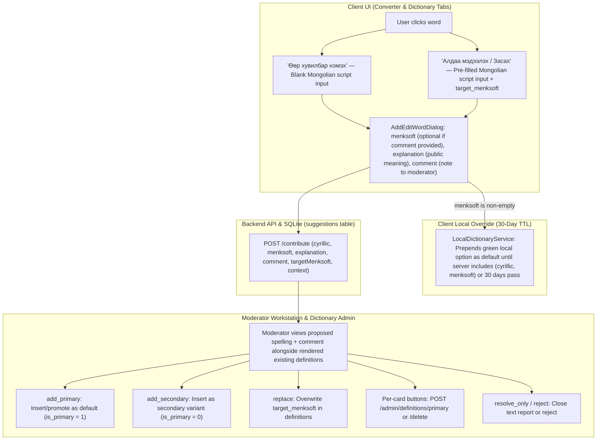

# Variant vs. Correction Differentiation & Moderation Pipeline

*   **Author:** suragch
*   **Status:** Approved
*   **Date:** 2026-11-10

--------------------------------------------------------------------------------

## Overview

The Cyrillic-to-Traditional-Mongolian Converter relies on community contributors and moderators to grow its dictionary and fix errors in existing entries. A single Cyrillic word can legitimately map to multiple traditional Mongolian script spellings (homonyms and classical/modern variants, such as `ор` $\to$ `` vs. ``), while existing definitions can also contain spelling mistakes, missing explanations, or wrong default ordering.

This design updates the submission dialog, client-side local dictionary override, and moderator workstation so that adding an alternate spelling and fixing or reporting an error on an existing spelling are clearly separated in the database and UI—without forcing contributors to classify their submission into a multi-category request-type dropdown.

## The Problem

Today, every user submission enters the `suggestions` table with a single text field (`explanation`), and approving a suggestion in `AppDatabase.approveSuggestion` unconditionally runs `addWordDefinition(..., isPrimary: true)`. This causes five concrete defects:

1. **Error corrections never replace erroneous spellings**: When a contributor submits a corrected spelling for an existing word and a moderator approves it, the backend inserts a new row into `definitions` and demotes the old spelling to `is_primary = 0`. The wrong spelling remains in the dictionary permanently as a secondary homonym.
2. **New variants hijack the default spelling**: When a contributor submits a secondary homonym variant for an existing word, approving it sets `is_primary = 1` on the new variant and demotes the established default spelling without moderator choice.
3. **Contributor error comments pollute public dictionary meanings**: In `ConverterScreen._showFlagErrorDialog`, clicking "Алдаа мэдээлэх / Засах" pre-fills `explanation` with `'Залруулга / Алдаатай байна'`. Because `approveSuggestion` copies `suggestions.explanation` directly into `definitions.explanation`, error-report comments leak into the public dictionary meaning shown to all users.
4. **Local overrides for known words are deleted immediately**: In `ConverterScreen.resolveLocalTokens`, any local dictionary entry whose Cyrillic word exists on the server (`t.type == 'word'`) is immediately added to `outRecognizedToPurge` and deleted. When a user submits a fix or variant for a known word, `_handleWordAddedOrSuggested` saves it locally and calls `_convert(force: true)`, which wipes the user's local override milliseconds after they submit it.
5. **Moderators lack visibility and queue prioritization**:
   - `ModeratorPage` shows only the count of existing definitions (`"Тольд одоо N бичлэг бүртгэлтэй байна"`) rather than rendering the existing spellings, leaving the moderator unable to see what is already in the dictionary or which spelling to replace or delete.
   - `DictionaryBrowseView` checks `def['isPrimary'] == true`, while the backend returns `'isDefault'`, so the `"Үндсэн утга"` (Primary) badge never renders.
   - `getPendingSuggestions` sorts strictly by `created_at ASC` and `_adminAddWordHandler` never resolves matching rows in `suggestions`, leaving stale duplicates (such as `монгол` and `ч`) in the queue.

### Proposed Solution Summary

1. **Separate Dictionary Meaning (`explanation`) from Contributor Note (`comment`)**: `AddEditWordDialog` provides two distinct text fields—one for the dictionary homonym meaning (`explanation`, saved to `definitions.explanation` if approved) and one for a free-text note to the moderator (`comment`, stored in `suggestions.comment` for error descriptions, deletion requests, or text-only reports when the contributor leaves the Mongolian script blank).
2. **Two Clear UI Entry Points**: Clicking a known word offers **"Өөр хувилбар нэмэх"** (opens the dialog with a blank Mongolian script box) and **"Алдаа мэдээлэх / Засах"** (opens the dialog pre-filled with the current Mongolian spelling and passes `target_menksoft` so the moderator sees which spelling the contributor clicked).
3. **30-Day Local Override + Pair-Match Purge**: Any non-empty `menksoft` submitted by the user is stored in `LocalDictionaryService` and placed at the top of `token.options` in green (`isLocal: true`) as the active default—while keeping the server's existing options selectable in the popup menu—until either the server's `/convert` response includes that exact `(cyrillic, menksoft)` pair or 30 days elapse.
4. **Explicit Moderator Operations**: The Moderator Workstation renders all existing definitions for the word in the right-hand panel and gives the moderator explicit controls to **Add as primary**, **Add as secondary variant**, **Replace an existing spelling**, **Close a text-only report**, or directly **Switch primary default** / **Delete an existing spelling** on any definition card.
5. **Queue Priority & Auto-Cleanup**: `getPendingSuggestions` prioritizes `db_discrepancy_review` items (`suggestions.submitted_by = 'db_discrepancy_review'`, representing 285 words withheld during import due to a spelling conflict between the base dictionary and the ECK source dictionary) first and user reports/edits ahead of bulk `eck_import` rows (`submitted_by = 'eck_import'`, representing bulk-imported multi-spelling homonym candidates), and direct moderator additions/updates automatically resolve matching pending suggestions.

## Goals

*   Separate public dictionary meanings (`explanation`) from contributor notes to the moderator (`comment`) across the client dialog, API, and SQLite `suggestions` table.
*   Support text-only error reports and deletion requests (where `comment` is non-empty and `menksoft` may be empty) without requiring contributors to pick from a request-type dropdown.
*   Preserve client-side local overrides in green (`isLocal: true`) for both unknown and known words until the server's `/convert` response includes that exact `(cyrillic, menksoft)` pair or 30 days pass.
*   Render existing definitions in the Moderator Workstation and Dictionary tab with direct moderator controls to add as primary, add as secondary, replace a specific spelling, edit an explanation, delete a spelling, or switch which spelling is primary (`is_primary = 1`).
*   Enforce the primary definition invariant: every word in `words` with $\ge 1$ definition in `definitions` has exactly one row with `is_primary = 1`, and deleting the last definition removes the parent `words` row.
*   Order the moderation queue with `db_discrepancy_review` items first, user submissions with comments/targets second, other user submissions third, and bulk `eck_import` rows fourth, while auto-resolving matching pending suggestions whenever a moderator defines a word elsewhere.

## Non-Goals

*   Forcing contributors to classify their submission using a multi-category request-type dropdown.
*   Automatic corpus-frequency selection of the default traditional-script homonym (requires a tagged traditional-script corpus).
*   Creating a separate `definition_history` table (audit history is preserved on the `suggestions` row via `target_menksoft` and `moderator_note`).
*   Restructuring the 285 `db_discrepancy_review` rows into multi-row records.

## Open Questions

*   None. All open questions from brainstorming have been resolved.

## Critical User Journeys (CUJs)

### CUJ 1: Contributor Proposes an Alternate Spelling (Homonym / Variant)

*   **Given**: The word `ор` exists in the dictionary with one spelling (``).
*   **When**: A user converts text containing `ор`, clicks the converted word, selects **"Өөр хувилбар нэмэх"**, enters `qr` (``) in the blank Latin field, enters `"ор дэрний ор"` in the dictionary meaning field (`explanation`), and clicks Submit.
*   **Then**:
    1. On the user's screen, `ор` immediately renders in green (`isLocal: true`) using `` as the active default at index `0`, while `` remains selectable in the popup menu, and subsequent `/convert` calls do not purge the local override until the server includes `` or 30 days pass.
    2. A suggestion row is created with `menksoft_code = ''`, `explanation = 'ор дэрний ор'`, and `target_menksoft = NULL`.

### CUJ 2: Contributor Corrects an Erroneous Spelling or Submits a Text-Only Report

*   **Given**: A word exists in the dictionary with an erroneous spelling `A`.
*   **When**: A user clicks the word, selects **"Алдаа мэдээлэх / Засах"** (which pre-fills `A` and records `target_menksoft = A`), either edits the spelling to `B` or clears the spelling and writes a description of the error in the moderator note field (`comment`), and submits.
*   **Then**:
    1. If the user entered a replacement spelling `B`, `B` overrides `A` in green on the user's screen for 30 days or until approved; if the user submitted a text-only `comment` with an empty spelling, a toast confirms submission to the moderator queue without altering local storage.
    2. The `suggestions` row records `target_menksoft = A` and `comment` (without polluting `explanation` with `'Залруулга / Алдаатай байна'`).

### CUJ 3: Moderator Reviews a Suggestion for an Existing Word

*   **Given**: A moderator opens the Moderator Workstation and views a suggestion for a word that already has one or more definitions in the dictionary.
*   **When**: The moderator inspects the proposed spelling, dictionary `explanation`, and contributor `comment` on the left/middle alongside the rendered list of existing dictionary definitions on the right (with any matching `target_menksoft` highlighted).
*   **Then**: The moderator can choose to **Add as primary** (`add_primary`), **Add as secondary variant** (`add_secondary`), **Replace the targeted/selected definition** (`replace`), **Close a text-only report** (`resolve_only`), or click ⭐ **Set Primary** / 🗑️ **Delete** directly on any existing definition card, and the dictionary updates atomically inside a SQLite transaction while preserving a single primary definition.


## Technical Plan (Architecture)

### 1. System Data Flow



### 2. SQLite Schema & Queue Ordering (`backend/lib/database.dart`)

#### 2.1 `suggestions` Table Columns
In `AppDatabase.initSchema()`, two nullable columns are added to `suggestions` via idempotent `ALTER TABLE` statements:

```sql
ALTER TABLE suggestions ADD COLUMN comment TEXT;
ALTER TABLE suggestions ADD COLUMN target_menksoft TEXT;
```

- `menksoft_code` (`TEXT NOT NULL`): Stores the contributor's proposed Mongolian spelling, or `''` (empty string) when the contributor submits a text-only error report or deletion request via `comment`.
- `explanation` (`TEXT`): Stores the public dictionary meaning / homonym disambiguation note to be copied into `definitions.explanation` if approved.
- `comment` (`TEXT`): Stores the contributor's free-text note or hint to the moderator (capped at $\le 500$ characters; never copied into `definitions.explanation`).
- `target_menksoft` (`TEXT`): Stores the existing `menksoft_code` the contributor clicked on when opening "Алдаа мэдээлэх / Засах". Preserved on the `suggestions` row as the before-spelling audit record if the moderator replaces it.
- `moderator_note` (`TEXT`): Existing column used to record the moderator's resolution action (`'add_primary'`, `'add_secondary'`, `'replace'`, `'resolve_only'`, `'auto_resolved'`) or rejection reason.

#### 2.2 Case Normalization, Startup Auto-Cleanup & Ongoing Auto-Resolution
1. **Cyrillic Case Normalization**: `AppDatabase.addSuggestion` normalizes `cyrillic` using `CyrillicValidator.normalizeWord(cyrillic)` on insert (matching `words.cyrillic`), because SQLite's built-in `LOWER()` only folds ASCII characters (`A-Z`) and does not fold Cyrillic characters (`А-ЯӨҮЁ`).
2. **Startup Sweep**: In `initSchema()`, after normalizing `cyrillic` on any existing `status = 'pending'` rows, any pending suggestion whose non-empty `(cyrillic, menksoft_code)` pair already exists in `words`/`definitions`—or whose `submitted_by = 'db_discrepancy_review'` word already exists in `words`—is updated to `status = 'approved', moderator_note = 'auto_resolved', context = NULL, reviewed_at = CURRENT_TIMESTAMP`. This cleans up stale duplicates such as `монгол` and `ч` while clearing `context` for privacy.
3. **Ongoing Auto-Resolution**: Whenever a moderator adds or replaces a definition `(cyrillic, menksoft)` via `addWordDefinition` or `replaceDefinition`, the database automatically resolves (setting `status = 'approved', moderator_note = 'auto_resolved', context = NULL, reviewed_at = CURRENT_TIMESTAMP`) any pending suggestion with matching normalized `(cyrillic, menksoft)` and any pending `db_discrepancy_review` row for `cyrillic`. Pending suggestions for `cyrillic` that have a different `menksoft_code` or a text-only report (`menksoft_code = ''`) are left untouched.

#### 2.3 Queue Priority Ordering (`getPendingSuggestions`)
`getPendingSuggestions` orders pending items across four priority tiers before sorting by `created_at ASC, id ASC`:
1. **Priority 0**: `submitted_by = 'db_discrepancy_review'` (the 285 base-vs-ECK discrepancy items).
2. **Priority 1**: User submissions (`submitted_by != 'eck_import'`) that include a non-empty `comment` or `target_menksoft` (error reports, deletion requests, and targeted fixes).
3. **Priority 2**: All other user submissions (`submitted_by != 'eck_import'`).
4. **Priority 3**: Bulk `eck_import` homonym rows.

`getPendingSuggestionsCount()` is also added and returned as `'total'` in `GET /admin/suggestions` so the header badge and Moderator tab display the full pending count rather than capping at the page batch size.

### 3. Moderator Operations & Primary Definition Invariant

Every word in `words` with $\ge 1$ row in `definitions` must have **exactly one** row with `is_primary = 1`. All multi-statement mutations (`addWordDefinition`, `replaceDefinition`, `deleteDefinition`, `setPrimaryDefinition`, and `approveSuggestion`) execute inside a re-entrant SQLite transaction helper `_runInTransaction<T>(T Function() action)` on `AppDatabase` so partial failures or composed calls can never violate the single-primary invariant:

- **`add_primary`**: Inserts `(word_id, menksoft_code, explanation, is_primary = 1)` (or updates `is_primary = 1` and `explanation` if `(word_id, menksoft_code)` already exists) and sets `is_primary = 0` on all other definitions for `word_id`.
- **`add_secondary`**: Inserts with `is_primary = 0` unless `word_id` currently has 0 definitions, in which case `is_primary = 1` is forced. If `(word_id, menksoft_code)` already exists, updates its `explanation` if a non-empty explanation was provided without demoting the current primary definition.
- **`replace`**: Replaces the definition matching `(word_id, target_menksoft)` with the new `menksoft_code` and `explanation`:
  - If `target_menksoft` is not specified and `word_id` has exactly 1 definition, targets that single definition.
  - If the new `menksoft_code` already exists on another definition row for `word_id` (and differs from `target_menksoft`), deletes the `target_menksoft` row and updates the surviving `menksoft_code` row, setting `is_primary = 1` if either row was primary.
  - Otherwise updates `menksoft_code`, `explanation`, and `verified_by` in place on the `target_menksoft` row, preserving its `is_primary` status (or promoting it if `isPrimary == true` was requested).
  - If `target_menksoft` is not found in `definitions`, falls back to `add_primary` (or `add_secondary` if `isPrimary == false`).
- **`resolve_only`**: Marks the suggestion `status = 'approved', moderator_note = 'resolve_only', context = NULL` without modifying `words`, `definitions`, or `unknown_logs` (whereas `add_primary`, `add_secondary`, and `replace` delete `cyrillic` from `unknown_logs`).
- **Direct Definition Management (`deleteDefinition` & `setPrimaryDefinition`)**:
  - `deleteDefinition`: Deletes the definition matching `(word_id, menksoft)`. If the deleted row had `is_primary = 1` and other definitions remain for `word_id`, promotes the oldest remaining definition (`ORDER BY id ASC LIMIT 1`) to `is_primary = 1`. If no definitions remain for `word_id`, deletes the parent row from `words`.
  - `setPrimaryDefinition`: Sets `is_primary = 1` on `(word_id, menksoft)` and `is_primary = 0` on all other definitions for `word_id`.

### 4. Backend HTTP API Contracts (`backend/bin/server.dart`)

1. **`POST /contribute` & `POST /suggest` (alias mounted to `_contributeHandler`)**:
   - Accepts `{ "cyrillic": "...", "menksoft": "...", "context": "...", "explanation": "...", "comment": "...", "targetMenksoft": "..." }`.
   - Validation: Requires valid Cyrillic word in `cyrillic` (`CyrillicValidator.isCyrillicWord`), requires at least one of `menksoft` or `comment` to be non-empty, and caps `comment` at 500 characters (`400 Bad Request` if exceeded).
2. **`GET /words/check` & `GET /admin/words/check`**:
   - `_queryDefinitionsByCyrillic` continues returning `{ "menksoft": "...", "explanation": "...", "isDefault": true/false }`, and both `DictionaryBrowseView` and `ModeratorPage` read `def['isDefault'] == true` for the primary badge.
3. **`GET /admin/suggestions` (`_adminSuggestionsHandler`)**:
   - Returns `{ "suggestions": [...], "total": <int> }`, where each item includes `comment` and `target_menksoft`.
4. **`POST /admin/suggestions/approve` (`_adminApproveHandler`)**:
   - Accepts `{ "id": <int>, "action": "add_primary" | "add_secondary" | "replace" | "resolve_only", "cyrillic": "...", "menksoft": "...", "explanation": "...", "targetMenksoft": "...", "moderatorId": "..." }`.
5. **Direct Moderator Dictionary Endpoints (Protected by `requireModerator`)**:
   - `POST /admin/definitions/update`: `{ "cyrillic": "...", "targetMenksoft": "...", "menksoft": "...", "explanation": "...", "isPrimary": true/false }` $\to$ calls `replaceDefinition`.
   - `POST /admin/definitions/delete`: `{ "cyrillic": "...", "menksoft": "..." }` $\to$ calls `deleteDefinition`.
   - `POST /admin/definitions/primary`: `{ "cyrillic": "...", "menksoft": "..." }` $\to$ calls `setPrimaryDefinition`.

### 5. Client Local Override & UI Architecture (`frontend/`)

1. **Local Override Lifecycle in `ConverterScreen.resolveLocalTokens`**:
   - Local entries in `LocalDictionaryService` expire after 30 days (`DateTime.now().difference(local.createdAt).inDays >= 30`).
   - For unknown words (`t.type == 'unknown'`), a non-empty local entry converts the token into a green `word` token (`isLocal: true`).
   - For known words (`t.type == 'word'`), the local entry is purged **only** when the server's `t.options` includes that exact `local.menksoft` spelling; otherwise, the local spelling is prepended at index `0` as the active default (`isLocal: true`, green dotted underline) while keeping the server's existing options selectable in the ambiguity menu.
2. **`AddEditWordDialog`**:
   - Separates `explanation` (`labelText: 'Тайлбар (заавал биш)'`, `helperText: 'Утгын тайлбар — ижил дуудлагатай үгийг ялгах'`) from `comment` (`labelText: 'Модераторт илгээх тайлбар / Алдааны мэдээлэл (заавал биш)'`).
   - Supports optional `showCommentField`, `allowEmptyMenksoftWhenCommentProvided`, and `showPrimaryCheckbox`.
3. **`ConverterScreen` Menus**:
   - Single-definition menu (`_showWordActionMenu`) and multi-definition menus (`_showAmbiguityMenu`, `_showAmbiguityBottomSheet`) offer both ➕ **Өөр хувилбар нэмэх** (blank Latin input) and ✏️ **Алдаа мэдээлэх / Засах** (pre-filled with the selected option's Latin transliteration and existing `explanation`, passing `targetMenksoft: selectedOption.menksoft`).
   - When a known word has a local override (`token.isLocal && token.options.length > 1`), clicking it opens the ambiguity menu so the user can still switch between their local override and the server's spellings, or click `"Хувийн толь засах / устгах"` to edit/remove their local override.
4. **`DictionaryBrowseView` & `ModeratorPage`**:
   - `DictionaryBrowseView` checks `def['isDefault'] == true` for the `"Үндсэн утга"` badge, provides guest `"Засах / Алдаа мэдээлэх"` on each definition card, and gives moderators direct ⭐ `"Үндсэн болгох"`, ✏️ `"Засах"`, and 🗑️ `"Устгах"` buttons on each definition card.
   - `ModeratorPage` renders `comment` in a distinct callout box, renders all existing definitions for the word in the right-hand column (highlighting any card matching `target_menksoft`, with clickable selection and direct ⭐ / 🗑️ buttons calling `/admin/definitions/primary` and `/admin/definitions/delete`), and provides explicit footer buttons for `add_primary`, `add_secondary`, `replace`, and `resolve_only`.


## Alternatives Considered

### Alternative A: Five-Category `suggestion_type` Enum (`new_word`, `new_variant`, `correction`, `delete_request`, `error_report`)

*   **Pros**: Gives each suggestion a discrete enum label in the database and allows rendering a color-coded category badge in the moderator queue.
*   **Cons**: Forces contributors to understand the difference between internal dictionary operations, or relies on which menu button they clicked even when they change their mind inside the dialog. If the moderator UI locks or defaults actions based on a mislabeled enum, a correction can still be approved as a variant or vice versa.
*   **Reason for Rejection**: Separating `explanation` (public dictionary meaning) from `comment` (contributor note to moderator) and showing the word's existing definitions right on the moderator review card gives the moderator complete context without needing a 5-way enum. On the client, prepending the user's submitted spelling as the green default while keeping existing server options in the dropdown works identically for both corrections and variants.

### Alternative B: Exposing `target_definition_id` Foreign Keys & Creating a Separate `definition_history` Table

*   **Pros**: Uses integer primary keys (`definitions.id`) to reference targeted definitions and stores a dedicated relational audit table for replacements and deletions.
*   **Cons**: Requires changing `/convert` and `/words/check` responses and client `TokenOption` models to expose internal SQLite row IDs. If a definition is deleted and re-added before a suggestion is reviewed, `ON DELETE SET NULL` erases the target reference. Adding a sixth table (`definition_history`) increases schema maintenance when `suggestions` already records every reviewed submission.
*   **Reason for Rejection**: `addWordDefinition` already enforces unique `(word_id, menksoft_code)` pairs, so the Mongolian spelling string (`target_menksoft`) uniquely identifies any definition without exposing database IDs, never breaks if row IDs shift, and preserves the old spelling directly on the `suggestions` row alongside `moderator_note`, `reviewed_by`, and `reviewed_at`.

### Alternative C: Automatic Corpus-Frequency Selection of the Default Homonym

*   **Pros**: Would automatically assign `is_primary = 1` to the most common traditional-script spelling when multiple spellings exist for a single Cyrillic word.
*   **Cons**: The 7.35 GB news corpus is written in Cyrillic, which counts Cyrillic word forms (e.g. `бол` or `ор`) rather than distinguishing which traditional-script spelling was used. Selecting between homonyms requires a large corpus written in traditional Mongolian script (or sense-disambiguated text), which is not available in the repository.
*   **Reason for Rejection**: Without a traditional-script corpus, automatic frequency ranking is impossible. Giving moderators explicit `"Үндсэн болгож нэмэх"` / `"Нэмэлт хувилбараар нэмэх"` approval buttons and a one-click `"Үндсэн болгох"` toggle on existing definitions provides deterministic control over the default spelling.

### Alternative D: Restructuring the 285 `db_discrepancy_review` Items into Multi-Candidate Rows

*   **Pros**: Would parse the ECK spelling out of the explanation string (`ECK зөрүү: Баазад: ... | ECK: ...`) into a separate structured column or candidate pair.
*   **Cons**: Requires a custom data migration script on the live production database when moderators can already edit (`E`) or approve (`1`) the discrepancy rows.
*   **Reason for Rejection**: Keeping the 285 discrepancy rows as-is, sorting them to the front of `getPendingSuggestions`, and automatically resolving them if a moderator defines the word elsewhere achieves the moderation goal with zero data-migration risk.

--------------------------------------------------------------------------------

## Non-Functional Requirements

*   **Privacy Preservation**: In accordance with existing privacy invariants in `AppDatabase.approveSuggestion` and `rejectSuggestion`, `suggestions.context` (the sentence snippet from the user's document) is cleared to `NULL` whenever a suggestion is approved, resolved (`resolve_only`), auto-resolved (`auto_resolved`), or rejected.
*   **Zero-Downtime SQLite Migration**: Adding `comment` and `target_menksoft` uses additive `ALTER TABLE suggestions ADD COLUMN ...` statements wrapped in `try / catch`, preserving `menksoft_code TEXT NOT NULL` (using `''` for text-only reports) so no table rebuild or lock-heavy migration is required on production startup.
*   **Client Storage Backward Compatibility**: `LocalDictionaryService` continues reading and writing the existing `LocalWordEntry` JSON format in `SharedPreferences`; no client storage migration or cache clear is required.

### Risks, Constraints & Mitigations

*   **Stale `target_menksoft` on Concurrent Edits**: If an existing spelling is modified or deleted before a second suggestion targeting `target_menksoft` is reviewed, `target_menksoft` may no longer match a current row in `definitions`. *Mitigation*: `ModeratorPage` renders all current definitions for the word and allows the moderator to click any definition card to select it as the replacement target; if `target_menksoft` is not found in `definitions`, `replaceDefinition` falls back to `addWordDefinition`.
*   **Input Size & Abuse Limits on Free-Text `comment`**: Allowing empty `menksoft` when `comment` is non-empty on unauthenticated `POST /contribute` could be abused for oversized payloads if unbounded. *Mitigation*: `_contributeHandler` still requires a valid single Cyrillic word (`CyrillicValidator.isCyrillicWord(cyrillic)`), trims `comment`, and enforces `comment.length <= 500` (returning `400 Bad Request` if exceeded), alongside `maxLength: 500` in `AddEditWordDialog`.
*   **Single Local Override per Cyrillic Word Constraint**: `LocalDictionaryService` is keyed by normalized Cyrillic word (`Map<String, LocalWordEntry>`). If a contributor submits two different local variants for the same Cyrillic word before moderation, their most recent submission is stored as the local green default while both submissions are queued on the server.


--------------------------------------------------------------------------------

## Detailed Implementation Plan

### Phase 1: Backend Schema, Database Operations, HTTP Routes & Backend Tests

#### 1. `backend/lib/database.dart` (Modify)

*   **Type / Scope**: Dart SQLite Database Service
*   **Rationale**: Adds schema columns for contributor notes and targeted spellings, wraps multi-statement operations in a re-entrant SQLite transaction, enforces the single-primary-definition invariant across additions/replacements/deletions, prioritizes discrepancy items in the queue, and auto-resolves duplicate pending suggestions while clearing `context = NULL`.
*   **Proposed Changes**:
    *   Add a private re-entrant transaction helper `T _runInTransaction<T>(T Function() action)` using a `bool _inTransaction = false` field (`BEGIN TRANSACTION` $\to$ `COMMIT` / `ROLLBACK`).
    *   In `initSchema()`:
        *   Execute additive `ALTER TABLE suggestions ADD COLUMN comment TEXT;` and `ALTER TABLE suggestions ADD COLUMN target_menksoft TEXT;` statements inside `try / catch` blocks.
        *   Normalize `cyrillic` in Dart (`CyrillicValidator.normalizeWord`) for any existing `suggestions` rows where `status = 'pending'`.
        *   Execute a startup `UPDATE` statement that marks pending `suggestions` rows as `status = 'approved', moderator_note = 'auto_resolved', context = NULL, reviewed_at = CURRENT_TIMESTAMP` when their non-empty `(cyrillic, menksoft_code)` pair already exists in `words`/`definitions` or when `submitted_by = 'db_discrepancy_review'` and `cyrillic` now exists in `words`.
    *   In `addSuggestion(...)`, add optional `String? comment` and `String? targetMenksoft` parameters, normalize `cyrillic` via `CyrillicValidator.normalizeWord(cyrillic)`, allow `menksoft` to be empty (`''`) when `comment` is non-empty, and write both fields into `suggestions`.
    *   Update `getPendingSuggestions({int limit = 100})` to select `comment` and `target_menksoft` and order by:
        ```sql
        ORDER BY
          CASE
            WHEN submitted_by = 'db_discrepancy_review' THEN 0
            WHEN COALESCE(submitted_by, '') != 'eck_import'
                 AND (COALESCE(comment, '') != '' OR COALESCE(target_menksoft, '') != '') THEN 1
            WHEN COALESCE(submitted_by, '') != 'eck_import' THEN 2
            ELSE 3
          END ASC,
          created_at ASC,
          id ASC
        LIMIT ?
        ```
        Add `int getPendingSuggestionsCount()` returning `SELECT count(*) FROM suggestions WHERE status = 'pending'`.
    *   Add `void _autoResolveMatchingSuggestions(String cyrillic, String menksoft)` that marks `status = 'approved', moderator_note = 'auto_resolved', context = NULL, reviewed_at = CURRENT_TIMESTAMP` on pending suggestions where `(cyrillic IN (?, ?) AND TRIM(menksoft_code) = ? AND TRIM(menksoft_code) != '')` or `(cyrillic IN (?, ?) AND submitted_by = 'db_discrepancy_review')` (passing `CyrillicValidator.normalizeWord(cyrillic)` and `cyrillic.trim()`).
    *   Update `addWordDefinition(...)` (wrapped in `_runInTransaction`) so that: (a) if `word_id` currently has zero definitions, `is_primary` is forced to `1`; (b) if `(word_id, menksoft_code)` already exists, its `is_primary` is promoted to `1` when `isPrimary == true` (demoting other rows for `word_id`) and its `explanation` is updated when a non-empty `explanation` is passed; and (c) `_autoResolveMatchingSuggestions(normalized, cleanMenksoft)` is called.
    *   Add `void replaceDefinition({required String cyrillic, required String targetMenksoft, required String newMenksoft, String? explanation, bool? isPrimary, String? verifiedBy})` (wrapped in `_runInTransaction`) to update an existing definition in place (or merge if `newMenksoft` already exists for `word_id`, or fall back to `addWordDefinition` if `targetMenksoft` is not found), maintaining the single-primary invariant and calling `_autoResolveMatchingSuggestions`.
    *   Add `bool deleteDefinition({required String cyrillic, required String menksoft})` (wrapped in `_runInTransaction`) to delete `(word_id, menksoft)` from `definitions`, promote the oldest remaining definition (`ORDER BY id ASC LIMIT 1`) to `is_primary = 1` if the deleted definition was primary, or delete the parent row from `words` if no definitions remain.
    *   Add `bool setPrimaryDefinition({required String cyrillic, required String menksoft})` (wrapped in `_runInTransaction`) to set `is_primary = 1` on the matching definition and `0` on all other definitions for `word_id`.
    *   Update `approveSuggestion(...)` (wrapped in `_runInTransaction`) to accept `String action = 'add_primary'` (`'add_primary'`, `'add_secondary'`, `'replace'`, `'resolve_only'`) and `String? targetMenksoft`, resolving `finalTargetMenksoft = (targetMenksoft != null && targetMenksoft.trim().isNotEmpty) ? targetMenksoft.trim() : (sug['target_menksoft'] as String?)?.trim()`, dispatching to the selected operation, setting `moderator_note = action` and `context = NULL`, and removing `cyrillic` from `unknown_logs` only when `action != 'resolve_only'`.
    *   Update `getFullDatabaseJson()` to include `comment` and `target_menksoft` in the `suggestions` export query.

#### 2. `backend/bin/server.dart` (Modify)

*   **Type / Scope**: Dart Shelf HTTP Server & Route Handlers
*   **Rationale**: Exposes the new contributor fields (`comment`, `targetMenksoft`), total pending suggestion count, approval `action` parameter, and direct moderator definition management endpoints.
*   **Proposed Changes**:
    *   In `_contributeHandler` (which serves both `POST /contribute` and its alias `POST /suggest`), read optional `comment` and `targetMenksoft` strings from the JSON request body. Require `cyrillic` to pass `CyrillicValidator.isCyrillicWord`, require at least one of `menksoft` or `comment` to be non-empty, and return `400 Bad Request` if `comment != null && comment.trim().length > 500`. Pass `comment` and `targetMenksoft` to `_db.addSuggestion`.
    *   In `_adminSuggestionsHandler`, include `'total': _db.getPendingSuggestionsCount()` in the JSON response map.
    *   In `_adminApproveHandler`, read optional `action` (defaulting to `'add_primary'`) and `targetMenksoft` from the JSON request body and pass them to `_db.approveSuggestion`.
    *   In `_router`, register three new moderator-protected routes (`requireModerator`):
        *   `POST /admin/definitions/update` ($\to$ `_adminUpdateDefinitionHandler`, calling `_db.replaceDefinition`)
        *   `POST /admin/definitions/delete` ($\to$ `_adminDeleteDefinitionHandler`, calling `_db.deleteDefinition`)
        *   `POST /admin/definitions/primary` ($\to$ `_adminSetPrimaryDefinitionHandler`, calling `_db.setPrimaryDefinition`)

#### 3. `backend/test/backend_test.dart` & `backend/test/server_test.dart` (Modify)

*   **Type / Scope**: Backend Unit & HTTP Integration Tests
*   **Rationale**: Verifies all new database operations, invariants, queue priority rules, and HTTP endpoints before touching frontend code.
*   **Proposed Changes**:
    *   Add unit tests in `backend_test.dart` for:
        *   `approveSuggestion` with `action: 'add_primary'`, `'add_secondary'`, `'replace'`, and `'resolve_only'` (including verifying `unknown_logs` retention on `'resolve_only'`).
        *   `replaceDefinition`, `deleteDefinition` (verifying automatic promotion of the next definition when the primary definition is deleted, and deletion of the `words` row when the last definition is deleted), and `setPrimaryDefinition`.
        *   Startup and ongoing auto-resolution of matching pending suggestions (including capitalized Cyrillic input and `context = NULL` verification) and `db_discrepancy_review` rows.
        *   4-tier queue priority ordering in `getPendingSuggestions`.
    *   Add HTTP tests in `server_test.dart` for:
        *   `POST /contribute` with `comment`, `targetMenksoft`, empty `menksoft` (text-only error report), and $> 500$-char `comment` rejection (`400`).
        *   `GET /admin/suggestions` returning `'total'`.
        *   `POST /admin/definitions/update`, `POST /admin/definitions/delete`, and `POST /admin/definitions/primary`.

*   **Phase 1 Verification Checkpoint**:
    ```bash
    dart format backend/ && cd backend && dart analyze --fatal-infos && dart test
    ```

---

### Phase 2: Frontend Dialog, Local Override Reconciliation, Dictionary & Moderator UI

#### 4. `frontend/lib/ui/dialogs/add_edit_word_dialog.dart` (Modify)

*   **Type / Scope**: Flutter Modal Dialog Widget
*   **Rationale**: Separates public dictionary meaning (`explanation`) from the contributor's note to the moderator (`comment`), supports text-only error reports when `comment` is provided, and allows moderators to choose whether a directly added/edited definition is primary.
*   **Proposed Changes**:
    *   Add optional parameters to `AddEditWordDialog`: `String? initialComment`, `bool showCommentField = false`, `bool allowEmptyMenksoftWhenCommentProvided = false`, `bool initialIsPrimary = true`, and `bool showPrimaryCheckbox = false`.
    *   Update `onSubmit` signature to `final Future<void> Function({required String cyrillic, required String menksoft, String? context, String? explanation, String? comment, bool isPrimary}) onSubmit;`.
    *   Keep `labelText: 'Тайлбар (заавал биш)'` on the explanation `TextField` (for widget test finder compatibility) with `helperText: 'Утгын тайлбар — ижил дуудлагатай үгийг ялгах'`.
    *   Add `_commentController` and render a `TextField` with `labelText: 'Модераторт илгээх тайлбар / Алдааны мэдээлэл (заавал биш)'` and `maxLength: 500` when `showCommentField` is true, and a `CheckboxListTile` (`"Үндсэн утга болгох"`) when `showPrimaryCheckbox` is true.
    *   Update `_submit()` validation so submission is allowed when `_previewMenksoft.isNotEmpty` or when `allowEmptyMenksoftWhenCommentProvided && _commentController.text.trim().isNotEmpty`.
    *   Update all 6 production callers of `AddEditWordDialog` to accept `String? comment` and `bool isPrimary = true` in their `onSubmit` callbacks:
        1. `_ConverterScreenState._showLocalWordDialog`
        2. `_ConverterScreenState._handleWordAddedOrSuggested`
        3. `_DictionaryBrowseViewState._addNewDefinition`
        4. `_DictionaryBrowseViewState._suggestWord`
        5. `_DictionaryBrowseViewState._editLocalWord`
        6. `_ModeratorPageState._addWord`

#### 5. `frontend/lib/main.dart` (Modify)

*   **Type / Scope**: Flutter Main Converter Screen & Token Reconciliation Logic
*   **Rationale**: Fixes the premature purge of local overrides on known words, enforces the 30-day TTL + `(cyrillic, menksoft)` pair-match purge rule, preserves homonym popup menu access on locally overridden multi-option words, and provides distinct "Add variant" vs. "Edit / Report error" menu entry points without polluting `explanation`.
*   **Proposed Changes**:
    *   In `ConverterScreen.resolveLocalTokens`:
        *   For each token `t` where `t.type == 'unknown' || t.type == 'word'`, compute `final norm = t.text.toLowerCase();` and look up `final local = localService.getWord(norm);`.
        *   If `local != null` and `DateTime.now().difference(local.createdAt).inDays >= 30`, add `norm` to `outRecognizedToPurge` and leave `t` unchanged.
        *   If `t.type == 'unknown'` and `local.menksoft.trim().isNotEmpty`, return a `word` token with `isLocal: true` and the local `TokenOption`.
        *   If `t.type == 'word'`, check whether `t.options` contains an option with `opt.menksoft.trim() == local.menksoft.trim()`. If matched, add `norm` to `outRecognizedToPurge` and return `t`. If not matched and `local.menksoft.trim().isNotEmpty`, return a `word` token with `isLocal: true` and `TokenOption(menksoft: local.menksoft, isDefault: true, explanation: local.explanation ?? 'Хувийн толь (Таны оруулсан хувилбар)')` prepended at index `0` ahead of `t.options` (with existing options' `isDefault` set to `false`).
    *   In `_handleTextFieldTap` and `_handleSecondaryTap`:
        *   If `token.isLocal && token.options.length == 1`, open `_showLocalWordDialog(token)`.
        *   If `token.options.length > 1` (including when `token.isLocal` is `true`), open `_showAmbiguityMenu(token, globalPos, tokenIndex: tokenIndex)`.
    *   In `_handleWordAddedOrSuggested` (and `_showLocalWordDialog` when saving a local word):
        *   Accept optional `String? comment`, `bool isPrimary = true`, and `String? targetMenksoft`.
        *   Only write to `LocalDictionaryService` and update `_tokens` locally when `menksoft.trim().isNotEmpty`. When saving a local word for `normalized`, remove any existing entry in `_selectedOptionIndices` for token indices matching `normalized` so the prepended local option at index `0` becomes active immediately.
        *   Include `comment` and `targetMenksoft` in the `POST /contribute` request body, and display a specific toast message when a text-only report is submitted vs. a spelling override.
    *   Add `_showAddVariantDialog(Token token, {int? tokenIndex})` (opens `AddEditWordDialog` with blank Latin field and `showCommentField: true`).
    *   Update `_showFlagErrorDialog(Token token, {int? tokenIndex, TokenOption? selectedOption})` so it pre-fills `initialLatin` and `initialExplanation` from `selectedOption` (removing the hardcoded `'Залруулга / Алдаатай байна'` string), enables `showCommentField: true` and `allowEmptyMenksoftWhenCommentProvided: true`, and passes `targetMenksoft: selectedOption?.menksoft`.
    *   In `_showWordActionMenu`, use string values `'add_variant'` (➕ `"Өөр хувилбар нэмэх"`), `'flag_error'` (✏️ `"Алдаа мэдээлэх / Засах"`), and `'copy_word'`.
    *   In `_showAmbiguityMenu` and `_showAmbiguityBottomSheet`, use integer sentinel values `-1` for ✏️ `"Алдаа мэдээлэх / Засах"`, `-2` for ➕ `"Өөр хувилбар нэмэх"`, and `-3` for `"Хувийн толь засах / устгах"` (shown when `token.isLocal` is `true`, opening `_showLocalWordDialog(token)`). Resolve `selectedOption` for `-1` via `final activeIdx = (tokenIndex != null ? (_selectedOptionIndices[tokenIndex] ?? 0) : 0).clamp(0, token.options.length - 1); final selectedOption = token.options.isNotEmpty ? token.options[activeIdx] : null;`.

#### 6. `frontend/lib/ui/dictionary/dictionary_browse_view.dart` (Modify)

*   **Type / Scope**: Flutter Dictionary Search & Browse View
*   **Rationale**: Fixes the missing `"Үндсэн утга"` badge, gives guests a per-definition edit/report button, and gives moderators direct per-definition controls to set primary, edit in place, or delete.
*   **Proposed Changes**:
    *   Check `def['isDefault'] == true || def['isPrimary'] == true` when rendering the `"Үндсэн утга"` badge (`Line 921`).
    *   In `_addNewDefinition`, pass `showPrimaryCheckbox: true` and `initialIsPrimary: definitions.isEmpty` to `AddEditWordDialog`, forwarding `isPrimary` to `POST /admin/words`.
    *   In `_suggestWord`, enable `showCommentField: true` and pass `comment` to `POST /contribute`.
    *   On each definition card in `_buildResultsArea`:
        *   For guests (`!_isModerator`): render a `"Засах / Алдаа мэдээлэх"` button that opens `AddEditWordDialog` pre-filled with that definition's Latin transliteration and explanation, `showCommentField: true`, `allowEmptyMenksoftWhenCommentProvided: true`, and `targetMenksoft: menksoft`.
        *   For moderators (`_isModerator`): render ⭐ `"Үндсэн болгох"` (when `!isPrimary`, calling `POST /admin/definitions/primary`), ✏️ `"Засах"` (opening `AddEditWordDialog` with `showPrimaryCheckbox: true` and calling `POST /admin/definitions/update`), and 🗑️ `"Устгах"` (confirming and calling `POST /admin/definitions/delete`).

#### 7. `frontend/lib/ui/moderator/moderator_page.dart` & `frontend/lib/ui/moderator/edit_suggestion_dialog.dart` (Modify)

*   **Type / Scope**: Flutter Moderator Workstation UI
*   **Rationale**: Tracks total pending count accurately, renders the contributor's `comment` separately from `explanation`, displays the word's existing dictionary definitions in the right-hand column, and provides explicit buttons for `add_primary`, `add_secondary`, `replace`, and `resolve_only`.
*   **Proposed Changes**:
    *   In `ModeratorPage`:
        *   Track `int _totalSuggestions = 0;` (initialized from `suggData['total'] as int? ?? newSuggestions.length` in `_loadData()` and decremented in `_advanceQueue()`), pass `_totalSuggestions` to `widget.onCountChanged` and the queue tab header, and reload `_loadData()` if `_suggestions` becomes empty while `_totalSuggestions > 0`.
        *   Track `String? _selectedTargetMenksoft` for the current suggestion, initialized to `current['target_menksoft']` (or to `definitions.first['menksoft']` when `definitions.length == 1`).
        *   In the left preview box, if `menksoft.trim().isEmpty`, render a centered placeholder (`"Текстэн мэдээлэл (Бичлэг оруулаагүй)"`).
        *   In the middle column, render a distinct callout box for `current['comment']` labeled `"Хэрэглэгчийн тэмдэглэл / Алдааны мэдээлэл (Зөвхөн модераторт):"` when `comment` is non-empty.
        *   In the right column, under the dictionary status banner, render each existing definition from `definitions` (showing vertical `MongolText`, Latin transliteration, `explanation`, `"Үндсэн"` badge when `def['isDefault'] == true`, and `"Сонгосон / Чиглүүлсэн"` highlight when `def['menksoft'] == _selectedTargetMenksoft`), allowing the moderator to click a card to select it as `_selectedTargetMenksoft`, or click ⭐ (`POST /admin/definitions/primary`) / 🗑️ (`POST /admin/definitions/delete`) directly to update the word's definitions in place.
        *   In `_handleApproveCurrent({String action = 'add_primary'})`, skip the `"Аль хэдийн бүртгэгдсэн байна"` and `"Олон утгатай үг (Homonym)"` dialogs when `action == 'replace'` or `action == 'resolve_only'`.
        *   In the footer action bar:
            *   When `menksoft.trim().isNotEmpty` and `!exists`: render `"Зөвшөөрөх (Үндсэн)"` (`action: 'add_primary'`, shortcut `1`).
            *   When `menksoft.trim().isNotEmpty` and `exists`: render `"Одоогийн бичлэгийг солих"` (`action: 'replace'`, passing `targetMenksoft: _selectedTargetMenksoft`, shortcut `1`), `"Нэмэлт хувилбараар нэмэх"` (`action: 'add_secondary'`, shortcut `4`), and `"Үндсэн болгож нэмэх"` (`action: 'add_primary'`).
            *   When `menksoft.trim().isEmpty` (or when `comment` is non-empty): render `"Шийдвэрлэсэн (Хаах)"` (`action: 'resolve_only'`, shortcut `1` when `menksoft` is empty).
            *   Keep `"Кирилл алдаатай"` (`2`), `"Үг биш"` (`3`), `"Засах"` (`E`), and `"Алгасах"` (`Space`).
    *   In `EditSuggestionDialog`: Display the contributor's `comment` (if present) for reference, skip the homonym warning when `initialMenksoft.trim().isEmpty` or when the suggestion has a `target_menksoft`, and when `"Хадгалаад батлах"` (`andApprove: true`) is clicked for an existing word (`exists == true`), pass `action: (_selectedTargetMenksoft != null) ? 'replace' : 'add_primary'` and `targetMenksoft: _selectedTargetMenksoft`.

*   **Phase 2 Verification Checkpoint**:
    ```bash
    dart format frontend/ && cd frontend && flutter analyze --fatal-infos
    ```

---

### Phase 3: Frontend Unit/Widget Tests & Documentation

#### 8. `frontend/test/converter_controller_test.dart` & `frontend/test/widget_test.dart` (Modify)

*   **Type / Scope**: Frontend Unit & Widget Tests
*   **Rationale**: Updates existing `AddEditWordDialog` test closures and verifies client-side local override persistence on known words, 30-day expiry, pair-match purging, and the updated dialog/dictionary/moderator UI widgets.
*   **Proposed Changes**:
    *   In `frontend/test/widget_test.dart`, update the 6 existing `AddEditWordDialog` `onSubmit` test closures (`Lines 418, 502, 550, 618, 702, 1022`) to accept optional `String? comment` and `bool isPrimary = true`.
    *   Add unit tests in `converter_controller_test.dart` for `ConverterScreen.resolveLocalTokens` verifying:
        *   Local override for a known word (`t.type == 'word'`) is NOT purged when the server does not return `local.menksoft`, and instead prepends the green local option at index `0` as default while preserving server options.
        *   Local override for a known word IS purged as soon as the server's `t.options` includes `local.menksoft`.
        *   Local override older than 30 days (`createdAt` $\ge 30$ days ago) is purged automatically.
    *   Add widget tests in `widget_test.dart` verifying:
        *   `AddEditWordDialog` renders the separate `comment` field and allows submitting a text-only report when `allowEmptyMenksoftWhenCommentProvided` is true.
        *   `DictionaryBrowseView` renders the `"Үндсэн утга"` badge and moderator definition action buttons.
        *   `ModeratorPage` renders existing definitions in the right column, displays contributor `comment`, and triggers `replace` / `add_secondary` / `add_primary` actions.

#### 9. Package & Directory Documentation (Modify)

*   **Target Files**:
    *   `backend/README.md`
    *   `backend/bin/README.md`
    *   `backend/lib/README.md`
    *   `frontend/lib/ui/dialogs/README.md`
*   **Type / Scope**: Package & Directory Documentation
*   **Rationale**: Keeps repository documentation synchronized with the new routes, database methods, and dialog fields.
*   **Proposed Changes**:
    *   Document `POST /admin/definitions/update`, `POST /admin/definitions/delete`, `POST /admin/definitions/primary`, the `comment` and `target_menksoft` columns, and the new `AddEditWordDialog` parameters.

### Final Verification Plan (Phase 3 Checkpoint)

*   **Formatting (Step 1)**: `dart format backend/ && dart format frontend/`
*   **Static Analysis & Linting (Step 2)**: `cd backend && dart analyze --fatal-infos && cd ../frontend && flutter analyze --fatal-infos` (zero warnings, lints, or infos allowed per `GEMINI.md`)
*   **Unit & Widget Tests (Step 3)**: `cd backend && dart test && cd ../frontend && flutter test`

--------------------------------------------------------------------------------

<!-- Provenance: Indicates initial structural drafting via EGM. -->

*Drafted with EGM*
